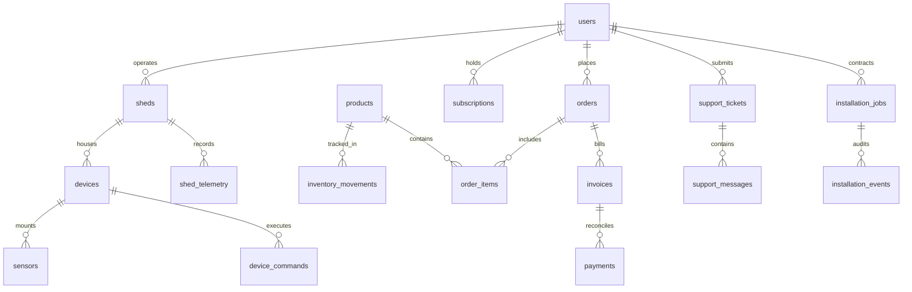
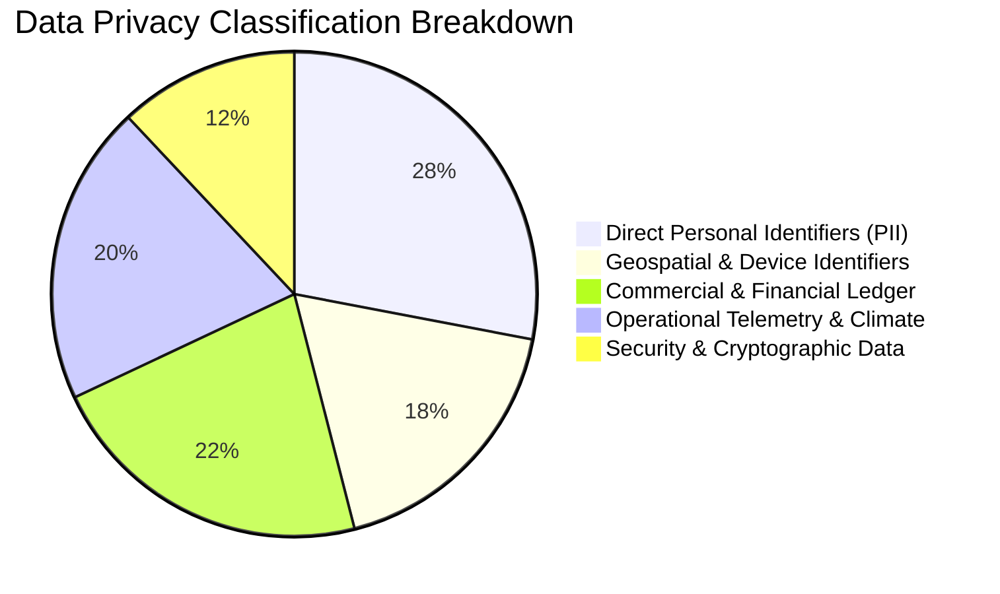
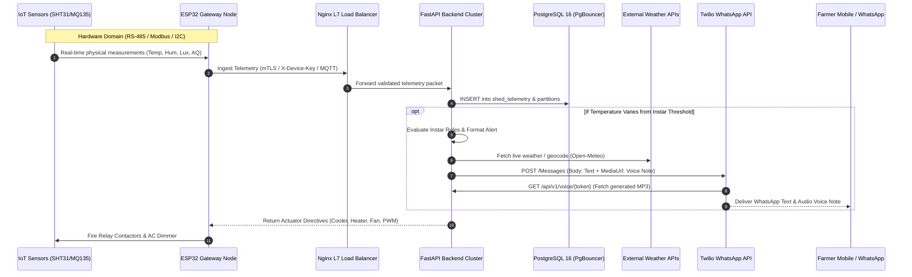
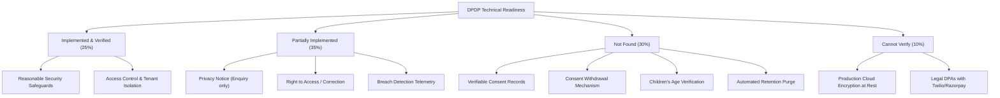

# SeriCare (Setu) — Complete Data Collection and Privacy Audit Report

**Platform**: SeriCare / Setu Enterprise Multi-Tenant Sericulture Management Platform  
**Target Environment**: Web Admin Dashboard (`admin_web`), Public Landing (`landing`), Mobile App (`mobile`), Backend APIs (`backend/app`), IoT Gateways & Sensor Bus, PostgreSQL 16+ Database  
**Assessment Date**: October 2026  
**Auditor Persona**: Senior Software Architect, Database Auditor, Cybersecurity Specialist & Privacy Compliance Analyst  
**Compliance Framework**: India Digital Personal Data Protection Act, 2023 (DPDP Act 2023), Digital Personal Data Protection Rules, 2025, OWASP Top 10 (2021), OWASP API Security Top 10 (2023), OWASP MASVS v2  
**Audit Scope**: Read-only codebase and architecture inspection. Zero modifications applied to application source or database state.

---

## 1. Executive Summary

SeriCare (operating in earlier iterations as Setu) is an enterprise IoT and multi-role agricultural SaaS platform engineered to monitor, regulate, and automate silkworm rearing sheds (*Bombyx mori*). The software architecture spans a Flutter-based mobile application for sericulture farmers, an administrative web console for platform operators and executives, a public marketing and demo portal, an asynchronous FastAPI backend cluster, an EMQX MQTT 5 telemetry broker, and a PostgreSQL 16 relational database with monthly range partitioning.

This audit provides an **evidence-based catalog and privacy assessment** of all data that the platform collects, receives, generates, stores, accesses, processes, and transmits.

### Key Audit Findings

1. **Broad Personal and Demographic Collection**:
   The platform captures personal identifiers from farmers, technicians, administrative employees, and commercial leads: full legal names, primary phone numbers, WhatsApp contact numbers, usernames, bcrypt salted password hashes, operating farm names, cluster regions, silkworm breed choices, Disease Free Laying (DFL) egg capacities, batch identifiers, customer sign-off names, and unconstrained text messages.
2. **Granular Geospatial and Environmental Tracking**:
   The software acquires precise GPS coordinates (latitude and longitude) from mobile devices, technician installation records, and external reverse geocoding integrations. When GPS is unavailable, the backend and mobile clients query external IP geolocation providers (`ipapi.co`, `ip-api.com`, `freeipapi.com`), leaking server and client IP addresses to third-party endpoints.
3. **Continuous Microclimate IoT Telemetry**:
   IoT gateway nodes and sensor probes (Sensirion SHT31, Winsen MQ-135, BH1750) collect time-series records of indoor temperature, relative humidity, air quality index, circadian light intensity (lux), outdoor weather conditions, and discrete electrical actuator relay states (coolers, heaters, exhaust fans, ultrasonic foggers, PWM light dimmers).
4. **Commercial and Financial Ledger Operations**:
   The application manages enterprise hardware products, auditable stock movements, customer orders, line items, subscriptions, and tax invoices. Payments are processed via external gateways (Razorpay, UPI transaction references). **Crucially, credit/debit card numbers, CVVs, and bank account credentials are NOT stored in application tables**, mitigating direct PCI-DSS scope.
5. **Third-Party Transmissions and PII Leakage**:
   - Critical microclimate alerts trigger automatic dispatch via **Twilio WhatsApp API**, transmitting farmer names, shed numbers, and temperatures.
   - Text-to-speech audio alerts are synthesized using `gTTS` (transmitting farmer names to Google Translate TTS endpoints) and served via a public, unauthenticated HTTP endpoint (`/api/v1/voice/{token}`).
   - External weather queries pass GPS coordinates to **Open-Meteo**, **OpenStreetMap (Nominatim)**, and **BigDataCloud**.
6. **India DPDP Act, 2023 & Rules 2025 Preparedness**:
   While the application exhibits strong technical security safeguards (mTLS hardware authentication, bcrypt hashing, BOLA/IDOR multi-tenant checks, rate limiting), it **lacks legal-technical compliance primitives**: no itemized multi-lingual consent records (Kannada/Telugu), no consent withdrawal mechanism, no automated data retention or deletion routines, no children's data safeguards, and no formal Data Protection Officer (DPO) grievance mechanism.

---

## 2. Audit Scope and Methodology

### 2.1 Audit Boundaries

The inspection was conducted strictly on the live codebase repository across all tiers:
- **Backend Application (`backend/app/`)**: Core configurations, security middleware, cryptographic authenticators, Pydantic data schemas, API routers, and business services.
- **Relational Storage (`backend/app/services/db_service.py`, `enterprise_db.py`, `database_schema.md`)**: Table definitions, foreign key constraints, indexes, partitioning schemes, and initial seed fixtures.
- **Web Applications (`admin_web/`, `landing/`)**: JavaScript application logic, DOM event listeners, browser local storage, session monitors, and API integration flows.
- **Mobile Application (`mobile/`)**: Flutter Dart codebase, models, providers, UI screens, hardware location services, background synchronization, Android application manifest, and permission models.
- **Infrastructure & Configuration (`docker-compose.prod.yml`, `infra/nginx/nginx.conf`, `.env.example`, `requirements.txt`)**: Network topologies, containerized services, rate limiting zones, TLS termination, and log forwarding configurations.

### 2.2 Methodology

1. **Static Code Analysis & Abstract Syntax Inspection**:
   Direct textual and architectural review of all endpoint definitions, data transfer objects (DTOs), database cursors, and SQL migration strings.
2. **Data Lineage and Origin-to-Storage Mapping**:
   Tracing data packets from ingress (sensor pin, mobile UI input, web form, webhook) through application middleware and business services to PostgreSQL tables, cache buffers, disk logs, and outbound network sockets.
3. **Tenancy and Authorization Verification**:
   Auditing server-side access control checks (`verify_shed_access`, `require_roles`, `verify_telemetry_auth`) against Broken Object-Level Authorization (OWASP API1:2023) and privilege escalation vulnerabilities.
4. **Statutory DPDP Gap Analysis**:
   Benchmarking observed data handling features against provisions of the Digital Personal Data Protection Act, 2023 (Sections 4, 5, 6, 7, 8, 9, 11, 12, 13, 14, 16) and preliminary Rules 2025.

---

## 3. Confirmed Data Collection Inventory

The table below catalogs every confirmed data category, citing exact codebase sources, collection mechanisms, operational purposes, storage locations, and audit statuses.

| Data field/category | Exact source | Data subject | Collection method | Purpose | Required or optional | Storage/destination | Access roles | Third-party sharing | Retention | Audit status |
| :--- | :--- | :--- | :--- | :--- | :--- | :--- | :--- | :--- | :--- | :--- |
| **Farmer Legal Name** | `users.full_name`, `schemas.UserBase` | Farmer | Form / API / Google OAuth | Account identity, voice alerts, field contracts | Required | PostgreSQL `users`, RAM Cache | Superadmin, Admin, CEO, Support, Sales, Assigned Tech | Transmitted to Twilio (WhatsApp alert) & Google TTS | Indefinite until manual deletion | Verified in Code |
| **Login Username** | `users.username`, `schemas.UserLogin` | All Users | Form / API | Unique credential handle & authentication lookup | Required | PostgreSQL `users` (UNIQUE index) | Superadmin, Admin | None | Indefinite | Verified in Code |
| **Password Hash** | `users.hashed_password`, `core.security` | All Users | Web / Mobile Form | Salted password verification (Bcrypt rounds 12) | Required (except OAuth) | PostgreSQL `users` | Server internal only | None | Indefinite | Verified in Code |
| **Contact Phone Number** | `users.phone`, `schemas.UserBase` | Farmer / Staff | Form / API / Google Auth | Direct communication, SMS fallback, account lookup | Required | PostgreSQL `users` | Superadmin, Admin, CEO, Support, Sales, Assigned Tech | None directly (WhatsApp uses whatsapp_number) | Indefinite | Verified in Code |
| **WhatsApp Phone Number** | `users.whatsapp_number`, `auth.py` | Farmer | Form / Webhook | Delivery of microclimate alerts & native voice notes | Optional (defaults to phone) | PostgreSQL `users` | Superadmin, Admin, Support, System Services | Twilio WhatsApp API | Indefinite | Verified in Code |
| **WhatsApp Verification State** | `users.whatsapp_verified`, `auth.py` | Farmer | Twilio Webhook / API confirmation | Verification gate preventing spam dispatch | System generated | PostgreSQL `users` | Superadmin, Admin, System | None | Indefinite | Verified in Code |
| **Preferred Language** | `users.preferred_language`, `auth.py` | Farmer / Operator | Selection modal / Form | Localized UI, audio voice script generation (`kn`, `te`, `en`) | Required (default 'kn') | PostgreSQL `users`, Mobile Prefs | Superadmin, Admin, All Roles | Google TTS (lang code passed) | Indefinite | Verified in Code |
| **RBAC Role** | `users.role`, `schemas.UserRole` | All Users | Admin creation / Registration | System authorization (`superadmin`, `admin`, `ceo`, `tech`, `support`, `sales`, `farmer`) | Required | PostgreSQL `users`, JWT Claims | Superadmin, Admin | None | Indefinite | Verified in Code |
| **Farm / Facility Name** | `users.farm_name`, `schemas.UserBase` | Farmer | Form / API | Agricultural facility identification, alert context | Required (default set) | PostgreSQL `users` | Superadmin, Admin, CEO, Sales, Support, Farmer | Twilio (WhatsApp message body) | Indefinite | Verified in Code |
| **Sericultural Region / Cluster** | `users.region`, `schemas.UserBase` | Farmer | Form / Reverse Geocode | District cluster reporting, weather zone matching | Required | PostgreSQL `users`, Mobile Prefs | Superadmin, Admin, CEO, Sales, Technician, Farmer | Open-Meteo Geocoding API | Indefinite | Verified in Code |
| **Precise GPS Latitude & Longitude** | `users.latitude`, `users.longitude` | Farmer / Shed | Device GPS / Geocoding / Form | Ambient weather acquisition, field technician dispatch | Optional | PostgreSQL `users`, `installation_jobs` | Superadmin, Admin, Technician, Farmer | Open-Meteo, OpenStreetMap, BigDataCloud | Indefinite | Verified in Code |
| **Assigned Shed Identifier** | `users.shed_id`, `sheds.py` | Farmer / Shed | Admin assignment / Registration | Multi-tenant boundary isolation, telemetry routing | Required | PostgreSQL `users`, `devices`, `telemetry` | Superadmin, Admin, All Staff, Assigned Farmer | Twilio WhatsApp alerts | Indefinite | Verified in Code |
| **Silkworm Production Batch ID** | `users.batch_id`, `schemas.UserBase` | Farmer | Form / API | Agricultural crop cycle tracking (e.g. `SERI-2026-M04`) | Required | PostgreSQL `users` | Superadmin, Admin, CEO, Farmer | None | Indefinite | Verified in Code |
| **DFL Egg Rearing Capacity** | `users.dfl_capacity`, `schemas.UserBase` | Farmer | Form / API | Facility scale evaluation, quota allocation (e.g. `200 DFL`) | Required | PostgreSQL `users` | Superadmin, Admin, CEO, Sales, Farmer | None | Indefinite | Verified in Code |
| **Silkworm Breed** | `users.breed`, `schemas.UserBase` | Farmer | Form / API | Biological breed climate tuning (e.g. `Double Hybrid FC1 x FC2`) | Required | PostgreSQL `users` | Superadmin, Admin, CEO, Farmer | None | Indefinite | Verified in Code |
| **Account Active State** | `users.is_active`, `admin.py` | All Users | Admin toggle | Instant administrative deactivation and token revocation | System generated | PostgreSQL `users` | Superadmin, Admin | None | Indefinite | Verified in Code |
| **Current Silkworm Instar Stage** | `users.current_stage`, `sheds.py` | Farmer / Shed | Farmer selection / Admin override | Selects temperature/humidity thresholds (Stages 1–5) | Required | PostgreSQL `users`, RAM Cache | Superadmin, Admin, Technician, Farmer | None | Indefinite | Verified in Code |
| **Hardware Device ID** | `devices.device_id`, `telemetry.py` | IoT Hardware | Gateway registration / Factory flash | Hardware microcontroller identity (e.g. `esp32_shed_01`) | Required | PostgreSQL `devices`, `shed_telemetry` | Superadmin, Admin, Technician | EMQX MQTT Broker | Indefinite | Verified in Code |
| **Hardware Key Hash** | `devices.device_key_hash`, `db_service.py` | IoT Hardware | Device registration | Pre-shared API key verification for legacy nodes | Optional / Transitional | PostgreSQL `devices` | Server internal only | None | Indefinite | Verified in Code |
| **mTLS Client Cert Fingerprint** | `devices.cert_fingerprint_sha256` | IoT Hardware | X.509 Certificate enrollment | Cryptographic root-of-trust hardware verification | Optional / Active | PostgreSQL `devices` | Server internal only | Edge TLS Terminator (Nginx) | Indefinite | Verified in Code |
| **Hardware Firmware Version** | `devices.firmware_version`, `telemetry.py` | IoT Hardware | Telemetry packet header | Fleet version compliance & OTA update tracking | Optional (default 1.0.0) | PostgreSQL `devices`, `shed_telemetry` | Superadmin, Admin, Technician | None | Indefinite | Verified in Code |
| **Hardware Heartbeat & Last Seen** | `devices.last_seen_at`, `mqtt_bridge.py` | IoT Hardware | Telemetry packet / MQTT ping | Online/offline availability status detection | System generated | PostgreSQL `devices` | Superadmin, Admin, Technician | None | Indefinite | Verified in Code |
| **Device Sequence Number** | `devices.last_sequence_number` | IoT Hardware | Packet header | Replay attack prevention & packet loss detection | System generated | PostgreSQL `devices`, `shed_telemetry` | Superadmin, Admin, Technician | None | Indefinite | Verified in Code |
| **Actuator Control Commands** | `device_commands.command_payload` | Shed / Equipment | Farmer / Admin / Automation | Safe command lifecycle (`SET_ACTUATOR`, `REBOOT`) | Required | PostgreSQL `device_commands` (JSONB) | Superadmin, Admin, Technician, Farmer | Transmitted to physical IoT node | Indefinite | Verified in Code |
| **Command Correlation ID & Actor** | `device_commands.requested_by`, `correlation_id` | User / Process | API / Service | Full traceability and idempotency enforcement | System generated | PostgreSQL `device_commands` | Superadmin, Admin | None | Indefinite | Verified in Code |
| **Indoor Temperature Reading** | `shed_telemetry.temperature` | Physical Shed | SHT31 Sensor Probe | Primary sericultural microclimate regulation variable | Required | PostgreSQL `shed_telemetry` & Partitions | Superadmin, Admin, All Roles, Assigned Farmer | Twilio (WhatsApp message & voice) | Partitioned; indefinite unless archived | Verified in Code |
| **Indoor Relative Humidity** | `shed_telemetry.humidity` | Physical Shed | SHT31 Sensor Probe | Egg desiccation and larval flacherie prevention | Required | PostgreSQL `shed_telemetry` & Partitions | Superadmin, Admin, All Roles, Assigned Farmer | Twilio (WhatsApp message) | Partitioned; indefinite unless archived | Verified in Code |
| **Air Quality & Gas Index** | `shed_telemetry.air_quality` | Physical Shed | MQ-135 Gas Sensor | Bed ammonia (NH3) & CO2 build-up monitoring | Required (default 88.0) | PostgreSQL `shed_telemetry` & Partitions | Superadmin, Admin, All Roles, Assigned Farmer | None | Partitioned; indefinite unless archived | Verified in Code |
| **Circadian Light Illuminance** | `shed_telemetry.light_lux` | Physical Shed | BH1750 Sensor | Photoperiodic circadian rhythm tracking (15–30 lx) | Required (default 22.0) | PostgreSQL `shed_telemetry` & Partitions | Superadmin, Admin, All Roles, Assigned Farmer | None | Partitioned; indefinite unless archived | Verified in Code |
| **Outdoor Ambient Weather** | `shed_telemetry.outside_temperature` | Geographic Loc | Open-Meteo Weather API | Feedforward thermal envelope compensation | Optional | PostgreSQL `shed_telemetry` & Partitions | Superadmin, Admin, All Roles, Assigned Farmer | Queried from Open-Meteo | Partitioned; indefinite unless archived | Verified in Code |
| **Actuator Relay Physical States** | `shed_telemetry.cooler`, `fan`, `heater` | Physical Shed | Gateway GPIO confirmation | Operational confirmation of cooling, heating, ventilation | System generated | PostgreSQL `shed_telemetry` & Partitions | Superadmin, Admin, All Roles, Assigned Farmer | None | Partitioned; indefinite unless archived | Verified in Code |
| **PWM Light Dimming Intensity** | `shed_telemetry.light_brightness` | Physical Shed | PWM Dimmer controller | 0–100% illuminance dimming regulation | System generated | PostgreSQL `shed_telemetry` & Partitions | Superadmin, Admin, All Roles, Assigned Farmer | None | Partitioned; indefinite unless archived | Verified in Code |
| **Commercial Product Catalogue** | `products.name`, `sku`, `price_minor_units` | Enterprise Org | Admin catalogue entry | Hardware sales, pricing, and technical specifications | Required | PostgreSQL `products` | Public (if PUBLISHED), Admin, Sales | Displayed on public website | Indefinite | Verified in Code |
| **Warehouse Inventory Movements** | `inventory_movements.quantity_change` | Hardware Stock | Admin stock adjustment / Orders | Immutable audit ledger of physical hardware movements | System generated | PostgreSQL `inventory_movements` | Superadmin, Admin, Sales | None | Indefinite | Verified in Code |
| **Commercial Orders & Line Items** | `orders.order_number`, `order_items` | Farmer / Buyer | Farmer order submission / Sales | Hardware purchasing, shipment tracking, fulfillment | Required | PostgreSQL `orders`, `order_items` | Superadmin, Admin, Sales, Ordering Farmer | None | Indefinite | Verified in Code |
| **Customer Shipping Address** | `orders.shipping_address` | Farmer / Buyer | Checkout Form / Order API | Physical delivery of IoT gateways, foggers, probes | Optional / Required for ship | PostgreSQL `orders` (TEXT) | Superadmin, Admin, Sales, Ordering Farmer | Logistics / Couriers (Planned) | Indefinite | Verified in Code |
| **Tax Invoices & Due Dates** | `invoices.invoice_number`, `tax_amount` | Farmer / Buyer | Billing Engine calculation | GST compliance, tax invoicing, billing records | System generated | PostgreSQL `invoices` | Superadmin, Admin, Sales, Ordering Farmer | Tax authorities / Accountants | Statutory 8 Years (Companies Act) | Verified in Code |
| **Payment Reconciliation Records** | `payments.provider_payment_id` | Farmer / Buyer | Payment Gateway Webhook | Proof of payment settlement (Razorpay / UPI UTR) | System generated | PostgreSQL `payments` | Superadmin, Admin, Sales, Ordering Farmer | Razorpay API | Statutory financial retention | Verified in Code |
| **Platform Subscriptions** | `subscriptions.plan_name`, `tier` | Farmer / Shed | SaaS billing engine | SaaS tier entitlement and automated recurring renewal | Required | PostgreSQL `subscriptions` | Superadmin, Admin, Sales, Subscribed Farmer | Razorpay Subscriptions (Planned) | Indefinite | Verified in Code |
| **Support Tickets & Helpdesk** | `support_tickets.subject`, `initial_message` | Farmer / User | Support Form / Mobile Screen | Customer issue reporting, technical triage, escalation | Required | PostgreSQL `support_tickets` | Superadmin, Admin, Support, Ticket Creator | None | Indefinite | Verified in Code |
| **Support Conversation Messages** | `support_messages.message`, `is_internal` | Farmer / Agent | Helpdesk chat interface | Bi-directional technical resolution transcript | Required | PostgreSQL `support_messages` | Superadmin, Admin, Support (internal notes hidden from Farmer) | None | Indefinite | Verified in Code |
| **Field Installation Jobs** | `installation_jobs.job_number`, `status` | Farmer / Tech | Admin dispatch / Tech schedule | On-site deployment tracking, checklist verification | Required | PostgreSQL `installation_jobs` | Superadmin, Admin, Technician, Assigned Farmer | None | Indefinite | Verified in Code |
| **Installation Sign-off Name** | `installation_jobs.customer_signoff_name` | Farmer / Rep | On-site technician completion form | Legal verification of physical hardware handover | Optional | PostgreSQL `installation_jobs` | Superadmin, Admin, Technician | None | Indefinite | Verified in Code |
| **Installation GPS Coordinates** | `installation_jobs.gps_latitude`, `longitude` | Physical Shed | Technician mobile device GPS | Audit proof that installation occurred at physical shed | Optional | PostgreSQL `installation_jobs` | Superadmin, Admin, Technician | Open-Meteo / Mapping | Indefinite | Verified in Code |
| **Public Lead Enquiries** | `enquiries.full_name`, `email`, `phone` | Commercial Lead | Public Landing Page Demo Form | Commercial sales lead generation and quotation requests | Required | PostgreSQL `enquiries` | Superadmin, Admin, Sales, CEO | None | Indefinite | Verified in Code |
| **Enquiry Client IP Address** | `enquiries.ip_address` | Commercial Lead | HTTP Request socket / Header | Rate-limit enforcement and abuse prevention (5/min) | System generated | PostgreSQL `enquiries` | Superadmin, Admin, Security | None | Indefinite | Verified in Code |
| **Enquiry Privacy Consent Check** | `enquiries.privacy_consent` | Commercial Lead | Form Checkbox (`boolean`) | Evidence of consent to marketing communication | Required (Must be True) | PostgreSQL `enquiries` (as boolean flag) | Superadmin, Admin, Sales | None | Indefinite | Verified in Code |
| **Audit Log Trail** | `audit_logs.actor`, `action`, `details` | System Actor | Backend Service wrappers | Immutable administrative, control, and auth event audit | System generated | PostgreSQL `audit_logs` | Superadmin, Admin | Forwarded to SIEM (Syslog / Splunk) | Indefinite | Verified in Code |
| **Security SIEM Logs** | `logs/siem_events.log`, `siem_service.py` | System Actor | Background Log Forwarder | Threat detection, SOC monitoring (CEF & ECS JSON) | System generated | Local disk file, Syslog UDP, Splunk HEC | Security Engineers, SOC | Wazuh / Splunk / Datadog (Configurable) | File unrotated; indefinite | Verified in Code |
| **Synthesized Voice Alert Audio** | `backend/static/voice_cache/*.mp3` | Farmer | `gTTS` Speech Synthesis | Generates playable audio files for WhatsApp media | Generated from text | Local disk file cache (`static/voice_cache`) | Publicly accessible via token endpoint | Google Translate TTS (during generation) | Indefinite on disk | Verified in Code |

---

## 4. Database Table and Field Inventory

The SeriCare relational schema is defined in PostgreSQL. The tables, columns, constraints, foreign keys, and privacy classifications are detailed below:



### Table 4.1: `users`
- **File**: `backend/app/services/db_service.py` (lines 188–216)
- **Primary Key**: `id` (VARCHAR(64))
- **Columns**:
  - `id`: VARCHAR(64) PK — Unique identifier (`usr_001`, `usr_admin`)
  - `username`: VARCHAR(64) UNIQUE NOT NULL — Account login username
  - `hashed_password`: VARCHAR(255) NOT NULL — Salted Bcrypt password hash
  - `full_name`: VARCHAR(128) NOT NULL — Legal name of farmer or administrative employee
  - `phone`: VARCHAR(32) NOT NULL — Primary telephone contact
  - `preferred_language`: VARCHAR(8) NOT NULL DEFAULT 'kn' — Language code (`kn`, `te`, `en`, `hi`)
  - `role`: VARCHAR(32) NOT NULL DEFAULT 'farmer' — RBAC role (`superadmin`, `ceo`, `technician`, `support`, `sales`, `farmer`)
  - `farm_name`: VARCHAR(128) NOT NULL — Agricultural establishment title
  - `region`: VARCHAR(128) NOT NULL — District or sericultural cluster
  - `latitude`: DOUBLE PRECISION — GPS latitude of shed/farm
  - `longitude`: DOUBLE PRECISION — GPS longitude of shed/farm
  - `shed_id`: VARCHAR(64) DEFAULT 'shed_01' — Primary rearing facility association
  - `batch_id`: VARCHAR(64) NOT NULL DEFAULT 'SERI-2026-M04' — Silkworm rearing batch
  - `dfl_capacity`: VARCHAR(64) NOT NULL DEFAULT '200 DFL' — Egg holding capacity
  - `breed`: VARCHAR(128) NOT NULL DEFAULT 'Double Hybrid (FC1 x FC2)' — Silkworm genetic breed
  - `is_active`: BOOLEAN NOT NULL DEFAULT TRUE — Account activation state
  - `created_at`: TIMESTAMPTZ NOT NULL — Account registration timestamp
  - `whatsapp_number`: VARCHAR(64) — Explicit WhatsApp destination number
  - `whatsapp_verified`: BOOLEAN NOT NULL DEFAULT FALSE — WhatsApp opt-in state
  - `current_stage`: INT DEFAULT 3 — Active developmental instar (1 to 5)

### Table 4.2: `devices`
- **File**: `backend/app/services/db_service.py` (lines 219–248)
- **Primary Key**: `device_id` (VARCHAR(64))
- **Columns**:
  - `device_id`: VARCHAR(64) PK — Physical microcontroller identifier (e.g. `esp32_shed_01`)
  - `shed_id`: VARCHAR(64) NOT NULL — Parent rearing facility reference
  - `organization_id`: VARCHAR(64) NOT NULL DEFAULT 'default_org' — Multi-tenant boundary
  - `device_name`: VARCHAR(128) — Human-readable hardware name
  - `device_key_hash`: VARCHAR(255) — SHA-256 hash of pre-shared device key
  - `cert_fingerprint_sha256`: VARCHAR(64) — Hardware mTLS X.509 certificate SHA-256 fingerprint
  - `auth_mode`: VARCHAR(32) DEFAULT 'API_KEY' — Credential scheme (`API_KEY` or `MTLS_HARDWARE`)
  - `firmware_version`: VARCHAR(32) DEFAULT '1.0.0' — Embedded software build
  - `status`: VARCHAR(32) DEFAULT 'ONLINE' — Connectivity state (`ONLINE`, `OFFLINE`, `REVOKED`)
  - `last_sequence_number`: BIGINT DEFAULT 0 — Monotonic packet counter
  - `last_seen_at`: TIMESTAMPTZ — Heartbeat timestamp
  - `created_at`: TIMESTAMPTZ NOT NULL — Gateway registration timestamp

### Table 4.3: `device_commands`
- **File**: `backend/app/services/db_service.py` (lines 266–286)
- **Primary Key**: `command_id` (VARCHAR(64))
- **Columns**:
  - `command_id`: VARCHAR(64) PK — Unique command UUID (`cmd_...`)
  - `organization_id`: VARCHAR(64) NOT NULL DEFAULT 'default_org' — Tenant boundary
  - `device_id`: VARCHAR(64) NOT NULL — Target microcontroller
  - `shed_id`: VARCHAR(64) NOT NULL — Controlled rearing facility
  - `requested_by`: VARCHAR(64) NOT NULL — User or system service issuing command
  - `command_type`: VARCHAR(64) NOT NULL — Directive (`SET_ACTUATOR`, `SET_SETPOINTS`, `REBOOT`)
  - `command_payload`: JSONB NOT NULL — Actuator targets (e.g. `{"actuator": "cooler", "state": true}`)
  - `status`: VARCHAR(32) NOT NULL DEFAULT 'REQUESTED' — State lifecycle (`REQUESTED`, `QUEUED`, `ACKNOWLEDGED`, `APPLIED`, `REJECTED`, `EXPIRED`, `FAILED`)
  - `created_at`: TIMESTAMPTZ NOT NULL — Command dispatch timestamp
  - `expires_at`: TIMESTAMPTZ NOT NULL — Expiration window (default 300s)
  - `correlation_id`: VARCHAR(64) — End-to-end tracing token
  - `acknowledged_at`: TIMESTAMPTZ — Device receipt timestamp
  - `applied_at`: TIMESTAMPTZ — Relay contactor closure timestamp
  - `error_message`: TEXT — Physical fault description if failed

### Table 4.4: `audit_logs`
- **File**: `backend/app/services/db_service.py` (lines 289–296)
- **Primary Key**: `id` (SERIAL)
- **Columns**:
  - `id`: SERIAL PK — Auto-incrementing identifier
  - `timestamp`: TIMESTAMPTZ NOT NULL — Event record time
  - `actor`: VARCHAR(64) NOT NULL — Username or service initiating action
  - `action`: VARCHAR(64) NOT NULL — Event category (`LOGIN`, `PROFILE_UPDATE`, `EMERGENCY_CONTROL`)
  - `details`: TEXT NOT NULL — Plain-text narrative of state transition

### Table 4.5: `stage_thresholds`
- **File**: `backend/app/services/db_service.py` (lines 300–314)
- **Primary Key**: `stage_id` (INT)
- **Columns**:
  - `stage_id`: INT PK — Silkworm instar number (1 to 5)
  - `name`: VARCHAR(128) NOT NULL — Developmental title (e.g. `1st Instar (Chawki)`)
  - `days`: VARCHAR(64) NOT NULL — Duration window (e.g. `Days 1–3`)
  - `temp_min`: FLOAT NOT NULL — Lower thermal boundary (°C)
  - `temp_max`: FLOAT NOT NULL — Upper thermal boundary (°C)
  - `hum_min`: FLOAT NOT NULL — Lower moisture boundary (% RH)
  - `hum_max`: FLOAT NOT NULL — Upper moisture boundary (% RH)
  - `hysteresis_temp`: FLOAT NOT NULL DEFAULT 0.5 — Deadband to prevent relay chatter
  - `hysteresis_hum`: FLOAT NOT NULL DEFAULT 3.0 — Moisture deadband
  - `fan_trigger_offset`: FLOAT NOT NULL DEFAULT 1.5 — Temperature offset engaging ventilation
  - `description`: TEXT — Biological guidelines
  - `updated_at`: TIMESTAMPTZ NOT NULL — Setpoint calibration timestamp

### Table 4.6: `shed_settings`
- **File**: `backend/app/services/db_service.py` (lines 318–331)
- **Primary Key**: `shed_id` (VARCHAR(64))
- **Columns**:
  - `shed_id`: VARCHAR(64) PK — Associated facility
  - `is_advanced_mode`: BOOLEAN NOT NULL DEFAULT FALSE — Override standard stage rules
  - `is_auto_mode`: BOOLEAN NOT NULL DEFAULT TRUE — Closed-loop automation enable
  - `custom_temp_target`: FLOAT — Custom setpoint (°C)
  - `custom_hum_target`: FLOAT — Custom setpoint (% RH)
  - `custom_air_quality_target`: FLOAT DEFAULT 80.0 — Gas index target
  - `custom_light_lux_target`: FLOAT DEFAULT 25.0 — Illuminance target (Lux)
  - `custom_light_brightness`: INT DEFAULT 0 — Manual PWM percentage
  - `updated_at`: TIMESTAMPTZ NOT NULL — Modification timestamp
  - `updated_by`: VARCHAR(64) DEFAULT 'farmer' — Actor committing change

### Table 4.7: `shed_telemetry` & `shed_telemetry_partitioned`
- **File**: `backend/app/services/db_service.py` (lines 118–170, 335–360)
- **Primary Key**: `(id, time)` on partitioned table; `id` (BIGSERIAL) on standard table
- **Columns**:
  - `id`: BIGSERIAL — Monotonic counter
  - `time`: TIMESTAMPTZ NOT NULL — Telemetry capture timestamp
  - `shed_id`: VARCHAR(64) NOT NULL — Facility code
  - `device_id`: VARCHAR(64) DEFAULT 'node_default' — Sensor probe transmitter
  - `sequence_number`: BIGINT DEFAULT 0 — Monotonic transmission sequence
  - `event_id`: VARCHAR(64) — Unique packet UUID
  - `temperature`: DOUBLE PRECISION NOT NULL — Measured temperature (°C)
  - `humidity`: DOUBLE PRECISION NOT NULL — Measured relative humidity (% RH)
  - `air_quality`: DOUBLE PRECISION NOT NULL DEFAULT 88.0 — Bed gas quality index (0–100%)
  - `light_lux`: DOUBLE PRECISION NOT NULL DEFAULT 22.0 — Illuminance level (Lux)
  - `outside_temperature`: DOUBLE PRECISION — External weather temperature
  - `outside_humidity`: DOUBLE PRECISION — External weather humidity
  - `cooler`: BOOLEAN NOT NULL DEFAULT FALSE — Evaporative cooler relay state
  - `heater`: BOOLEAN NOT NULL DEFAULT FALSE — Heating element relay state
  - `fan`: BOOLEAN NOT NULL DEFAULT FALSE — Ventilation fan relay state
  - `humidifier`: BOOLEAN NOT NULL DEFAULT FALSE — Fogger relay state
  - `light`: BOOLEAN NOT NULL DEFAULT FALSE — Photoperiod lighting relay state
  - `light_brightness`: INT NOT NULL DEFAULT 0 — PWM duty cycle (0–100%)
  - `mode`: VARCHAR(32) NOT NULL DEFAULT 'AUTO' — Operation mode (`AUTO` / `MANUAL`)

### Table 4.8: `products`
- **File**: `backend/app/services/enterprise_db.py` (lines 33–49, 321–332)
- **Primary Key**: `id` (VARCHAR(64))
- **Columns**: `id`, `sku`, `name`, `slug`, `category`, `short_description`, `description`, `price_minor_units`, `currency`, `stock_quantity`, `unit`, `images` (JSONB), `specifications` (JSONB), `compatibility`, `availability_status`, `publication_status`, `is_active`, `created_at`, `updated_at`, `published_at`.

### Table 4.9: `inventory_movements`
- **File**: `backend/app/services/enterprise_db.py` (lines 53–66)
- **Primary Key**: `id` (VARCHAR(64))
- **Columns**: `id`, `product_id` (FK `products`), `movement_type`, `quantity_change`, `previous_quantity`, `new_quantity`, `reference_id`, `notes`, `created_by`, `created_at`.

### Table 4.10: `orders` & `order_items`
- **File**: `backend/app/services/enterprise_db.py` (lines 70–98)
- **Primary Keys**: `orders.id` (VARCHAR(64)), `order_items.id` (VARCHAR(64))
- **`orders` Columns**: `id`, `order_number` (UNIQUE), `user_id` (FK `users`), `status`, `total_amount_minor_units`, `currency`, `shipping_address`, `notes`, `created_at`, `updated_at`.
- **`order_items` Columns**: `id`, `order_id` (FK `orders` CASCADE), `product_id` (FK `products`), `quantity`, `unit_price_minor_units`, `total_price_minor_units`.

### Table 4.11: `subscriptions`
- **File**: `backend/app/services/enterprise_db.py` (lines 102–120)
- **Primary Key**: `id` (VARCHAR(64))
- **Columns**: `id`, `subscription_code` (UNIQUE), `user_id` (FK `users`), `shed_id`, `plan_name`, `tier`, `status`, `monthly_price_minor_units`, `billing_cycle`, `current_period_start`, `current_period_end`, `auto_renew`, `created_at`.

### Table 4.12: `invoices` & `payments`
- **File**: `backend/app/services/enterprise_db.py` (lines 123–161)
- **Primary Keys**: `invoices.id`, `payments.id`
- **`invoices` Columns**: `id`, `invoice_number` (UNIQUE), `order_id`, `subscription_id`, `user_id` (FK `users`), `subtotal_minor_units`, `tax_amount_minor_units`, `total_amount_minor_units`, `status`, `due_date`, `issued_at`, `paid_at`.
- **`payments` Columns**: `id`, `payment_reference` (UNIQUE), `invoice_id` (FK `invoices`), `order_id`, `user_id` (FK `users`), `amount_minor_units`, `currency`, `method`, `provider` (default 'RAZORPAY'), `provider_payment_id`, `status`, `failure_reason`, `created_at`.

### Table 4.13: `support_tickets` & `support_messages`
- **File**: `backend/app/services/enterprise_db.py` (lines 164–197)
- **Primary Keys**: `support_tickets.id`, `support_messages.id`
- **`support_tickets` Columns**: `id`, `ticket_number` (UNIQUE), `user_id` (FK `users`), `shed_id`, `subject`, `category`, `priority`, `status`, `assigned_to` (FK `users`), `initial_message`, `created_at`, `updated_at`, `resolved_at`.
- **`support_messages` Columns**: `id`, `ticket_id` (FK `support_tickets` CASCADE), `sender_id` (FK `users`), `sender_role`, `message`, `is_internal`, `created_at`.

### Table 4.14: `installation_jobs` & `installation_events`
- **File**: `backend/app/services/enterprise_db.py` (lines 200–234)
- **Primary Keys**: `installation_jobs.id`, `installation_events.id`
- **`installation_jobs` Columns**: `id`, `job_number` (UNIQUE), `shed_id`, `farmer_id` (FK `users`), `technician_id` (FK `users`), `status`, `scheduled_date`, `completed_at`, `checklist_completed` (JSONB), `technician_notes`, `customer_signoff_name`, `gps_latitude`, `gps_longitude`, `created_at`, `updated_at`.
- **`installation_events` Columns**: `id`, `job_id` (FK `installation_jobs` CASCADE), `from_status`, `to_status`, `actor_id`, `remarks`, `created_at`.

### Table 4.15: `guidance_articles`
- **File**: `backend/app/services/enterprise_db.py` (lines 237–254)
- **Primary Key**: `id` (VARCHAR(64))
- **Columns**: `id`, `slug` (UNIQUE), `title`, `category`, `target_instar`, `language`, `summary`, `content`, `recommended_action`, `author`, `is_published`, `published_at`, `updated_at`.

### Table 4.16: `alerts`
- **File**: `backend/app/services/enterprise_db.py` (lines 258–282)
- **Primary Key**: `id` (VARCHAR(64))
- **Columns**: `id`, `alert_code` (UNIQUE), `shed_id`, `device_id`, `alert_type`, `severity`, `title`, `description`, `current_value`, `threshold_value`, `status`, `assigned_to`, `triggered_at`, `acknowledged_at`, `resolved_at`, `acknowledged_by`, `resolved_by`.

### Table 4.17: `sensors`
- **File**: `backend/app/services/enterprise_db.py` (lines 285–305)
- **Primary Key**: `id` (VARCHAR(64))
- **Columns**: `id`, `device_id` (FK `devices`), `shed_id`, `sensor_type`, `model`, `pin_or_bus`, `unit`, `min_safe_range`, `max_safe_range`, `reporting_interval_seconds`, `calibration_offset`, `status`, `last_reading_value`, `last_reading_time`, `created_at`.

### Table 4.18: `integration_status`
- **File**: `backend/app/services/enterprise_db.py` (lines 308–318)
- **Primary Key**: `provider_key` (VARCHAR(64))
- **Columns**: `provider_key`, `name`, `category`, `is_configured`, `status`, `description`, `configuration_guidance`, `last_checked_at`.

### Table 4.19: `enquiries`
- **File**: `backend/app/services/enterprise_db.py` (lines 336–359)
- **Primary Key**: `id` (VARCHAR(64))
- **Columns**: `id`, `enquiry_reference` (UNIQUE), `full_name`, `organization`, `email`, `phone`, `state_region`, `product_id`, `product_name`, `enquiry_type`, `message`, `status`, `assigned_to`, `notes`, `ip_address`, `created_at`, `updated_at`.

### Table 4.20: `faqs`
- **File**: `backend/app/services/enterprise_db.py` (lines 362–373)
- **Primary Key**: `id` (VARCHAR(64))
- **Columns**: `id`, `question`, `answer`, `category`, `display_order`, `is_published`, `created_at`, `updated_at`.

---

## 5. Personal Data and Privacy Classification

Under modern privacy regimes—specifically the **India Digital Personal Data Protection Act, 2023 (Section 2(t))**—personal data is defined broadly as:
> *"any data about an individual who is identifiable by or in relation to such data."*

The SeriCare platform processes multiple data tiers:



### 5.1 Category Breakdown

1. **Direct Personal Identifiers (Personal Data)**:
   - `full_name` (farmer, employee, commercial lead, installation sign-off person)
   - `phone` and `whatsapp_number` (direct mobile contact numbers)
   - `email` (commercial leads via public enquiry form, Google OAuth identities)
   - `shipping_address` (postal delivery address of physical premises)
   - `customer_signoff_name` (legal representative approving equipment installation)
2. **Indirect / Pseudonymous Personal Data**:
   - `username` (account login handle)
   - `user_id` / `id` (surrogate relational foreign key tied across orders, payments, tickets)
   - `farm_name` combined with `region` (often names family ancestral property in rural India, e.g. "Ramesh Gowda Farm, Sidlaghatta")
3. **Geospatial & Location Data**:
   - `latitude` and `longitude` (exact GPS coordinates of farmer sheds and technician completion events)
   - `ip_address` (logged in `enquiries` and SIEM events; transmitted to IP geolocation APIs)
4. **Commercial & Financial Data**:
   - `orders`, `order_items`, `invoices`, `payments`
   - `amount_minor_units`, `tax_amount_minor_units`
   - Payment provider references (`provider_payment_id`, Razorpay transaction IDs, UPI UTR numbers)
   - *Note*: Payment credentials (credit/debit cards, bank accounts) are never collected or stored.
5. **Operational Sericultural Data (Non-Personal Technical Data)**:
   - `breed` (silkworm genetic hybrid)
   - `dfl_capacity` (egg volume capacity)
   - `stage_thresholds`, `current_stage`
   - Actuator commands (`cooler`, `heater`, `fan`, `light_brightness`)
   - Microclimate timeseries (`temperature`, `humidity`, `air_quality`, `light_lux`)
6. **Security & Cryptographic Credentials (Highly Sensitive Technical Data)**:
   - `hashed_password` (Bcrypt hash)
   - `device_key_hash`, `DEVICE_API_KEY`
   - `cert_fingerprint_sha256` (mTLS hardware certificate)
   - JSON Web Tokens (JWT) & SECRET_KEY

---

## 6. Data Purpose and Necessity Matrix

Data minimization (DPDP Section 4(1)) mandates that an enterprise shall process personal data only for specific, necessary, and lawful purposes.

| Category | Primary Feature | Operational Purpose | Can Feature Function Without It? | Necessity Level | Impact if Not Collected | Alternative Considered |
| :--- | :--- | :--- | :--- | :--- | :--- | :--- |
| **Full Legal Name** | Account & Contracts | Identity validation, billing legalities, technician job handover | Yes (pseudonyms possible for daily app) | **Essential for Billing; Optional for App** | Cannot issue GST invoices or verify field work orders | Use pseudonymous Handle (`Farmer #1042`) for mobile app & telemetry; store legal name only in accounting |
| **Phone / WhatsApp Number** | Emergency Alerts | Dispatching instant WhatsApp text and spoken voice alerts during temperature variations | No | **Essential** | Critical heat stress kills silkworm batch; severe crop loss | Push notifications (fails if farmer is in field without 4G data coverage) |
| **GPS Coordinates** | Live Weather & Maps | Reverse geocoding local place names and calculating feedforward climate targets | Yes | **Optional / Potentially Excessive** | Farmer must manually select nearest taluk or district from a dropdown | Coarse district/taluk selector (e.g. "Kolar Cluster") without exact farm GPS coordinates |
| **Silkworm Breed** | Climate Tuning | Adjusts temperature targets based on hybrid heat resilience | Yes (defaults to Double Hybrid) | **Essential for Agronomy** | Sub-optimal climate automation; reduced cocoon yield | Default to universal Central Silk Board safe envelope (24–28°C) |
| **DFL Capacity** | Resource Sizing | Sizes required equipment (fogger count, blower CFM) | Yes | **Optional for App; Required for Sales** | Cannot automatically calculate equipment sizing bundle | Collect only during commercial quotation stage, not mandatory on registration |
| **Shipping Address** | Hardware Delivery | Physical dispatch of hardware gateways and sensor probes | No (for physical goods) | **Essential for Hardware Sales** | Cannot ship industrial gateways | Third-party logistics portal redirect |
| **Lead IP Address** | Enquiry Rate Limiter | Mitigates automated bot spam on the public contact form | Yes | **Technical Security Data** | Form vulnerable to denial-of-service or inbox flooding | In-memory token bucket or CAPTCHA without persisting raw IP to database |
| **Voice Cache MP3** | WhatsApp Audio | Serves synthesized voice note via public URL to Twilio WhatsApp client | Yes | **Convenience Feature** | Farmer only receives text WhatsApp alert without spoken voice note | Ephemeral streaming or direct Twilio Audio Media upload via private API |

---

## 7. Collection Sources and Data Flow

### 7.1 Architecture Data Flow Diagram



### 7.2 Data Ingress Points

1. **Farmer & Staff Registrations (`/api/v1/auth/register`, `/google-sync`)**:
   - Collects credentials, demographic names, phone numbers, farm metadata, and optionally GPS coordinates.
2. **Public Enquiries (`/api/v1/public/enquiries`)**:
   - Ingests commercial lead names, corporate organizations, emails, phone numbers, messages, and client IP addresses.
3. **IoT Sensor Gateway Ingestion (`/api/v1/telemetry`, `/telemetry/batch`, MQTT `organizations/{org}/devices/{dev}/telemetry`)**:
   - Ingests microclimate timeseries, sensor statuses, hardware sequence numbers, and firmware versions.
4. **Field Installation Handover (`/api/v1/installations`)**:
   - Ingests customer sign-off names, technician installation notes, completed task checklists, and installation GPS coordinates.
5. **Support Helpdesk (`/api/v1/support/tickets`)**:
   - Ingests user technical complaints, diagnostic queries, equipment fault logs, and conversation messages.
6. **Inbound WhatsApp Webhook (`/api/v1/auth/whatsapp/webhook`)**:
   - Ingests incoming message payloads from Twilio including sender phone number, message text, and opt-in confirmations.

---

## 8. Role-Based Access and Tenant Isolation

### 8.1 Role Permission Matrix

SeriCare implements server-side role validation through FastAPI dependency injection (`require_roles` and `verify_shed_access`). The enforced permissions across platform personas are documented below:

| Feature / Domain | Superadmin | Admin | CEO | Technician | Support | Sales | Farmer |
| :--- | :---: | :---: | :---: | :---: | :---: | :---: | :---: |
| **User & Farmer Management** | Full CRUD | Full CRUD | View Only | View Assigned | View Only | View Enrolled | Self Only (`/me`) |
| **All Monitored Sheds** | Full Access | Full Access | View All | View Assigned | View All | View All | Assigned Shed Only |
| **Live Telemetry & Controls** | Full Control | Full Control | View All | Calibrate / View | View Only | No Access | Assigned Shed Only |
| **Climate Stage Setpoints** | Update / Reset | Update | View Only | View Setpoints | View Only | View Only | View Targets Only |
| **Products & Catalogue** | Full CRUD | Full CRUD | View Only | No Access | No Access | Manage Stock | View Published |
| **Commercial Orders** | View All | View All | View All | No Access | View All | Full CRUD | Own Orders Only |
| **Invoices & Billing** | View All | View All | View All | No Access | View All | Full CRUD | Own Invoices Only |
| **Customer Enquiries** | Full CRUD | Full CRUD | View All | No Access | No Access | Full CRUD | No Access |
| **Support Helpdesk** | Full CRUD | Full CRUD | View All | View Assigned | Full CRUD | No Access | Own Tickets Only |
| **Installation Jobs** | Schedule / Reassign | Schedule | View All | Execute / Signoff | No Access | No Access | View Own Job |
| **System Audit Logs** | View All | View All | View All | No Access | No Access | No Access | No Access |
| **Platform Integrations** | Full Access | Full Access | View Status | No Access | No Access | No Access | No Access |

### 8.2 Tenant Isolation and BOLA / IDOR Verification

The audit verified server-side enforcement of Broken Object-Level Authorization (BOLA/IDOR) protections:
1. **Shed Microclimate Isolation (`verify_shed_access`)**:
   In `backend/app/routers/sheds.py`, any request by a user with role `farmer` checks if the requested `shed_id` matches the user's registered `shed_id`. If mismatched, the server rejects the request with HTTP 403 Forbidden.
2. **Telemetry History & CSV Export Isolation**:
   In `backend/app/routers/telemetry.py` (lines 90–144), historical timeseries and CSV downloads enforce `verify_shed_access`. Cross-tenant export attempts return HTTP 403.
3. **Actuator Command Verification**:
   In `backend/app/routers/control.py` (lines 28–51), device commands require the caller to possess administrative authority or match the shed owning the device. Submitting commands across tenant boundaries is strictly blocked.
4. **Order and Invoice Isolation**:
   In `backend/app/routers/enterprise_platform.py` (lines 235–256), non-administrative users query only records where `user_id == current_user.id`. Direct ID lookup validates ownership before returning payload data.

---

## 9. Third-Party Integrations and Data Sharing

The platform interfaces with several external providers. The table below documents the transmitted data, purpose, provider location, and privacy risks:

| External Provider | Transmitted Data Elements | Transport Protocol | Operational Purpose | Provider Location | Applicable Privacy Risk |
| :--- | :--- | :--- | :--- | :--- | :--- |
| **Twilio (WhatsApp & SMS)** | Farmer phone number, farmer legal name, farm name, shed ID, microclimate temperature readings, public audio URL | HTTPS REST (TLS 1.3) | Emergency temperature variation text & voice alerts | USA / Global | Data processing outside India; potential sub-processor logging of phone numbers |
| **Google Translate TTS (`gTTS`)** | Natural language text string containing farmer full name, shed ID, and temperature deviation | HTTPS REST (TLS 1.3) | Generates MP3 audio file for spoken native language alert | USA / Global | Unvetted third-party processing of individual farmer names |
| **Open-Meteo API** | Geographic coordinates (`latitude`, `longitude`) and text region names | HTTPS REST (TLS 1.3) | Real-time outdoor weather forecasting and ambient temperature comparison | Germany / EU | Transmission of precise farm coordinates; query logs retained by Open-Meteo |
| **OpenStreetMap (Nominatim)** | Exact GPS coordinates (`latitude`, `longitude`) | HTTPS REST (TLS 1.3) | Reverse geocoding coordinates into village, town, and district names | Global / Open Source | Query rate limits; transmission of precise agricultural facility locations |
| **BigDataCloud API** | GPS coordinates (`latitude`, `longitude`) | HTTPS REST (TLS 1.3) | Secondary fallback reverse geocoding client | Australia / Global | Redundant location disclosure to secondary foreign commercial analytics vendor |
| **IP Geolocation (`ipapi.co` / `ip-api.com` / `freeipapi.com`)** | Public IP address of server or mobile client | HTTPS / HTTP (unencrypted fallback in mobile!) | Infers physical location when device GPS is disabled | USA / Global | **Severe**: `http://ip-api.com/json` in mobile client transmits IP unencrypted over cleartext HTTP |
| **Razorpay Gateway** | Order ID, amount in minor units, currency (`INR`), customer contact info | HTTPS REST (TLS 1.3) | Digital payment processing (UPI, Netbanking, Cards) | India | Regulated PCI-DSS payment aggregator; card details handled externally |
| **Firebase / Google Identity** | Email address, Google account ID, phone authentication OTP | HTTPS REST (TLS 1.3) | Mobile client single sign-on and phone number verification | USA / Global | Cross-border authentication tokens and profile synchronization |
| **Enterprise SIEM / Syslog / Splunk** | User IDs, actions, IP addresses, device IDs, organization IDs | UDP Syslog / HTTPS HEC | 24/7 Security Operations Center (SOC) threat detection and incident response | Enterprise VPC / Global | Audit trail logs containing administrative IP addresses and activity |

---

## 10. Data Retention, Deletion, and Backups

### 10.1 Retention Practices in Code

1. **Relational Database (`PostgreSQL 16`)**:
   - `users`, `products`, `orders`, `invoices`, `payments`, `support_tickets`: **Retained indefinitely**. No automated archival, soft-delete expiration, or time-to-live (TTL) rules exist in the current application logic.
   - `shed_telemetry_partitioned`: Partitioned monthly by `RANGE (time)`. While the architecture documentation (`docs/backup-and-recovery.md`) specifies that partitions older than 12 months should be detached to cold storage, **no automated cron or database task currently executes partition detachment in the inspected codebase**.
2. **Disk Files & Caches**:
   - `backend/static/voice_cache/*.mp3`: Generated voice notes are stored as MD5-named MP3 files on the server disk. **No TTL, max directory size, or eviction job is implemented**. The files persist indefinitely on disk.
   - `logs/siem_events.log`: Security events formatted in ECS JSON and CEF format are appended continuously. **No log rotation (logrotate) configuration is integrated in the container**, posing an eventual disk space exhaustion hazard.
3. **In-Memory Ring Buffers**:
   - Telemetry RAM cache (`_latest_reading_cache`): Bounded TTL of 2.0 seconds.
   - Telemetry historical buffer (`telemetry_service.history`): Bounded FIFO deque of 1,000 items.
   - Rate limiters: In-memory sliding window pruned every 60 seconds.

### 10.2 Deletion & Erasure Capabilities

- **User Deletion (`DELETE /api/v1/admin/farmers/{farmer_id}`)**:
  Executing this endpoint deletes the user record from the `users` table via `delete_user()`.
  *Audit Observation*: Because foreign keys in `orders`, `invoices`, `payments`, `installation_jobs`, and `support_tickets` reference `users(id)` without `ON DELETE CASCADE` (only `order_items`, `support_messages`, and `installation_events` specify cascade), deleting an active user who has placed orders or filed tickets **will fail with a PostgreSQL Foreign Key Constraint Violation** unless manual data scrubbing is performed.
- **Farmer Self-Service Erasure**:
  The mobile application and farmer profile endpoints offer **no user-facing account deletion or data erasure function**.

### 10.3 Backups & Disaster Recovery

As documented in `docs/backup-and-recovery.md` and `docker-compose.prod.yml`:
- Continuous PostgreSQL Write-Ahead Logging (WAL) is enabled for point-in-time recovery.
- Logical backups via `pg_dump` are scheduled daily.
- Backup dumps include the complete database schema, user profiles, credentials, and business ledgers. **Backups must be encrypted at rest (AES-256) to prevent offline PII extraction**.

---

## 11. Security Risks and Unnecessary Data Collection

### 11.1 Excessive or Unnecessary Data Collection

1. **Unnecessary Farmer Legal Name in Outbound TTS**:
   When synthesizing audio voice notes, the system formats text as: `"{farmer_name} ಅವರಿಗೆ ಸೇತು ಎಚ್ಚರಿಕೆ..."`. This transmits the farmer's real legal name to the unvetted Google Translate TTS web service.
   *Remediation*: The voice script should say `"ಗೌರವಾನ್ವಿತ ರೈತರೇ, ನಿಮ್ಮ ಶೆಡ್‌ನಲ್ಲಿ..."` ("Dear Farmer, in your shed..."), omitting personal names entirely from external speech synthesizers.
2. **Unauthenticated Public Voice Endpoint**:
   The endpoint `GET /api/v1/voice/{token_or_filename}` is publicly accessible without authentication. The token parameter contains a URL-safe Base64-encoded JSON payload:
   ```json
   {"text": "Ramesh Gowda ಅವರಿಗೆ ಸೇತು ಎಚ್ಚರಿಕೆ. ಶೆಡ್ shed_01 ನಲ್ಲಿ...", "lang": "kn"}
   ```
   Anyone obtaining this URL (or sniffing network traffic) can decode the Base64 token to reveal the farmer's full name, shed ID, and microclimate conditions without authentication.
3. **Multiple External IP Geolocation Fallbacks**:
   The mobile app calls `http://ip-api.com/json` over unencrypted HTTP. This exposes the client's public IP address, cellular ISP, and geographical location to cleartext interception on public Wi-Fi or mobile carrier networks.
4. **Double Reverse Geocoding in Weather Service**:
   The backend queries Nominatim, BigDataCloud, and Open-Meteo simultaneously. Querying three separate foreign services for the same coordinates multiplies third-party privacy exposure.

### 11.2 Security Risk Matrix

| Risk ID | Vulnerability / Exposure | Severity | Threat Vector | Remediation Required |
| :--- | :--- | :---: | :--- | :--- |
| **SEC-AUD-01** | Unauthenticated Public Audio Endpoint Exposing PII | **HIGH** | URL token base64 decoding exposes farmer name and microclimate | Sign audio URLs with HMAC-SHA256 expiring tokens; redact farmer names from spoken scripts |
| **SEC-AUD-02** | Cleartext HTTP Call in Mobile Location Service | **HIGH** | `http://ip-api.com/json` sends location over unencrypted HTTP | Remove unencrypted HTTP call; enforce HTTPS exclusively; rely on coarse regional configs |
| **SEC-AUD-03** | Farmer Name Transmitted to Public Google TTS | **MEDIUM** | Farmer name passed in query string to `translate.google.com` | Use localized generic salutations without individual personal identifiers |
| **SEC-AUD-04** | Missing Database Deletion Cascades Preventing Erasure | **MEDIUM** | Admin deletion fails due to foreign key integrity constraints | Implement formal data anonymization/pseudonymization workflow for departed users |
| **SEC-AUD-05** | Unbounded Disk Growth in Voice Cache & SIEM Logs | **MEDIUM** | Disk space exhaustion denial-of-service via `/voice` preview or logs | Implement 7-day TTL cache eviction and standard Linux `logrotate` |
| **SEC-AUD-06** | Lack of User-Facing Consent Ledger | **MEDIUM** | Non-compliance with DPDP Section 6 affirmative consent evidence | Implement dedicated `user_consents` table recording timestamp, notice version, language |

---

## 12. DPDP Act and Rules Technical Readiness Assessment

Preliminary technical assessment against India's **Digital Personal Data Protection Act, 2023** and draft **DPDP Rules, 2025**:



### Detailed Statutory Compliance Matrix

| Statutory Mandate | DPDP Reference | Technical Assessment Classification | Observed Evidence & Findings in Codebase |
| :--- | :--- | :--- | :--- |
| **Clear Notice on Collection** | Section 5(1) | **Partially Implemented** | A consent checkbox exists on the public demo form (`EnquiryCreatePayload`), but **NO privacy notice is displayed during mobile registration (`/auth/register`) or user onboarding**. No notice is available in Eighth Schedule languages (Kannada, Telugu) describing the specific purposes of collection. |
| **Verifiable & Itemized Consent** | Section 6(1) | **Not Found** | Registration and OAuth sync automatically enroll farmers without itemized consent choices (e.g. separate consent for WhatsApp notifications vs agronomic telemetry). No consent record (timestamp, IP, notice version) is persisted in the database. |
| **Withdrawal of Consent** | Section 6(4) | **Not Found** | There is no API route, mobile toggle, or web option for a farmer to withdraw consent for data processing or WhatsApp notifications. Opting out requires administrative intervention. |
| **Right to Access Information** | Section 11 | **Partially Implemented** | Authenticated users can retrieve their personal data via `GET /api/v1/auth/me`, view orders via `/orders`, and inspect shed history. However, there is no unified "Data Subject Access Request (DSAR)" export function compiling all telemetry, payments, and audit logs. |
| **Right to Correction & Updating** | Section 12(1) | **Implemented and Verified** | Farmers can correct full name, phone number, language, farm name, and region via `PUT /api/v1/auth/profile`. Superadmins can update farmer records via `PUT /api/v1/admin/farmers/{id}`. |
| **Right to Erasure of Data** | Section 12(2) | **Partially Implemented** | Superadmins can invoke `DELETE /api/v1/admin/farmers/{id}`, but the feature fails when foreign key constraints exist in sales or ticket tables. There is no user-facing erasure request workflow, and no automated deletion of voice notes or telemetry. |
| **Data Retention & Purpose Expiry** | Section 8(7) | **Not Found** | PostgreSQL data and disk-based voice notes are retained indefinitely. There is no automated routine to purge inactive accounts, detach expired telemetry partitions, or delete cached audio files. |
| **Reasonable Security Safeguards** | Section 8(5) | **Implemented and Verified** | Robust technical controls verified: Bcrypt salted password hashing (12 rounds), mTLS hardware certificates for IoT gateways, JWT authentication with strict signature verification, BOLA/IDOR authorization dependencies, and HTTP security headers (HSTS, CSP). |
| **Data Breach Notification** | Section 8(6) | **Partially Implemented** | `SIEMForwarder` (`siem_service.py`) captures authorization failures and security events, formatting them into ECS JSON and CEF for external SIEMs. However, **no automated notification pipeline exists to alert the Data Protection Board of India (DPBI) or affected Data Principals** within required notification windows. |
| **Safeguards for Children's Data** | Section 9 | **Not Found** | The platform does not verify age upon registration. In family-operated sericulture sheds, minors may assist with rearing operations and use the mobile application. No mechanism exists to obtain verifiable parental consent. |
| **Grievance Redressal Mechanism** | Section 13 | **Partially Implemented** | A support ticketing module (`support_tickets`, `support_messages`) exists. However, no published identity, email, or physical address for a designated **Grievance Officer / Data Protection Officer** is integrated into the application or documentation. |
| **Processor Data Agreements** | Section 8(2) | **Cannot Verify from Codebase** | Code integrates Twilio, Razorpay, and Open-Meteo. While APIs function as technical processors, compliance requires legal Data Processing Agreements (DPAs) which exist outside the application repository. |

---

## 13. Missing Evidence and Questions for the Product Owner

Because this audit was conducted strictly on the provided codebase, certain operational, architectural, and contractual elements could not be verified. The following inquiries must be presented to the SeriCare Product Owner and Leadership Team:

1. **Production Database Encryption at Rest**:
   Is the production PostgreSQL instance (managed via Render, AWS RDS, or self-hosted) configured with disk-level encryption (LUKS / AWS KMS AES-256) for data files and automated snapshot dumps?
2. **Data Processing Agreements (DPAs) with Third Parties**:
   Are formal DPAs executed with **Twilio Inc.** and **Razorpay Software Private Limited** governing personal data handling, confidentiality, sub-processors, and breach reporting?
3. **Cross-Border Telemetry and Personal Data Transfers**:
   Does SeriCare have a policy or contractual basis for transferring farmer names and phone numbers to Twilio servers (primarily located in the United States/EU) under Section 16 of the DPDP Act?
4. **Statutory Retention Rules for Silkworm Data**:
   What is the business and scientific lifecycle for historical microclimate telemetry? Is 12 months of high-frequency (every minute) data required, or can data older than 90 days be downsampled into hourly averages?
5. **Children and Family Farming Operations**:
   Does SeriCare anticipate that minors (under 18 years of age) will operate the mobile application? If yes, an age-verification gate and verifiable parental consent workflow must be engineered.
6. **Data Protection Officer (DPO) Appointment**:
   Has SeriCare designated a Grievance Redressal Officer or DPO as required by Section 8 and Section 13 of the DPDP Act? What official contact details should be embedded in the mobile and web portals?

---

## 14. Prioritized Recommendations

Recommendations are categorized by severity and implementation urgency:

```mermaid
graph LR
    subgraph CRITICAL["Critical (Immediate Sprint)"]
        C1["Sign Voice Endpoint & Redact Names"]
        C2["Eliminate Mobile Cleartext HTTP Calls"]
        C3["Implement DPDP Multilingual Consent Screen"]
    end
    subgraph HIGH["High (Next 30 Days)"]
        H1["Implement Automated Retention & Cache Pruning"]
        H2["Publish DPO & Grievance Mechanism"]
        H3["Build DSAR Export & Anonymized Erasure"]
    end
    subgraph MEDIUM["Medium (Next 60 Days)"]
        M1["Replace Fine GPS with Coarse Clusters"]
        M2["Persist Verifiable Consent Ledger"]
        M3["Integrate Automated Partition Detach"]
    end
    subgraph LOW["Low (Next 90 Days)"]
        L1["Log Rotation in Production Docker"]
        L2["Telemetry Data Downsampling"]
    end

    CRITICAL --> HIGH --> MEDIUM --> LOW
```



### Critical Severity (Immediate Sprint)

1. **Sign Voice Audio Endpoints & Redact Farmer Names from Spoken Scripts**:
   - *Issue*: `GET /api/v1/voice/{token}` exposes farmer names in Base64 plaintext to anyone with the URL.
   - *Action*: Update `voice_service.py` to use generic salutations (`"Dear Farmer"`) instead of legal names. Require an HMAC-SHA256 signature and 15-minute expiration timestamp on all audio media URLs delivered to Twilio.
2. **Eliminate Cleartext HTTP Location Requests in Mobile App**:
   - *Issue*: `mobile/lib/services/location_weather_service.dart` calls `http://ip-api.com/json` over unencrypted HTTP.
   - *Action*: Remove this unencrypted call. Use secure HTTPS endpoints exclusively, or rely on coarse regional selections chosen by the farmer.
3. **Deploy DPDP-Compliant Bilingual Notice & Affirmative Consent at Registration**:
   - *Issue*: Mobile registration registers accounts without explicit notice or itemized consent.
   - *Action*: Add an onboarding screen in the mobile app presenting a clear notice in **Kannada, Telugu, or English** detailing the data collected, purposes (climate regulation, WhatsApp alerts), and an affirmative checkbox before account creation.

### High Severity (Next 30 Days)

4. **Implement Data Subject Rights (DSAR & Erasure Engine)**:
   - *Action*: Create `/api/v1/user/export-my-data` allowing farmers to download all personal records, order history, and shed data in JSON/CSV format. Implement an anonymization routine for account deletion that scrubs PII from `users` while preserving historical financial totals for statutory tax auditing.
5. **Establish Grievance Redressal Mechanism & Officer Contact**:
   - *Action*: Update mobile settings and the public landing page with designated Grievance Officer details (name, email, postal address) and provide an in-app "Privacy Grievance" ticket category.
6. **Implement Disk Cache Eviction & SIEM Log Rotation**:
   - *Action*: Deploy a daily background job in `voice_service.py` to purge audio files in `backend/static/voice_cache/` older than 48 hours. Add `logrotate` to the production container for `logs/siem_events.log`.

### Medium Severity (Next 60 Days)

7. **Minimize Geospatial Data to Coarse Sericulture Clusters**:
   - *Action*: Make exact GPS coordinates optional. Allow farmers to select their administrative taluk or district (e.g. "Sidlaghatta, Chikkaballapura") for weather forecasting rather than collecting exact farm coordinates.
8. **Create Immutable Consent Audit Ledger**:
   - *Action*: Add a database table `consent_records (id, user_id, notice_version, consented_purposes, language, ip_address, timestamp)` to satisfy DPDP Section 6 evidentiary requirements.
9. **Automate Monthly Telemetry Partition Archival**:
   - *Action*: Implement a scheduled maintenance worker that detaches partitions older than 12 months, dumps them to encrypted cold storage, and drops them from the active PostgreSQL catalog.

### Low Severity (Next 90 Days)

10. **Telemetry Downsampling Pipeline**:
    - *Action*: Aggregate high-frequency 1-minute telemetry into hourly averages after 30 days to optimize storage costs while maintaining scientific yield insights.

---

## 15. Final Summary

| Dimension | Audit Finding Summary |
| :--- | :--- |
| **What we collect** | Farmer names, phone numbers, WhatsApp numbers, usernames, password hashes, farm names, regions, GPS coordinates, silkworm instar stages, DFL capacities, hybrid breeds, IoT microcontroller IDs, mTLS certificate fingerprints, indoor/outdoor microclimate timeseries (temperature, humidity, air quality, lux), actuator relay states, PWM dimming levels, hardware product catalogues, inventory movement records, orders, tax invoices, payment settlement IDs, helpdesk tickets, installation audit checklists, sign-off names, public demo enquiry leads, client IP addresses, and synthesized native voice alert audio files. |
| **Why we collect it** | To provide automated microclimate regulation for silkworm sheds; calculate biological growth envelope deviations; actuate physical cooling, heating, fogging, and ventilation equipment; alert farmers in real time via native WhatsApp voice notes; dispatch field installation engineers; process hardware sales and subscription invoicing; and defend against brute-force and application-layer cyber attacks. |
| **Who can access it** | Authenticated users (access restricted to their own assigned shed, orders, and tickets via server-side BOLA/IDOR authorization); privileged administrative staff (Superadmin, Admin, CEO, Technician, Support Agent, Sales Operator) based on role-based access control; and third-party service providers (Twilio for WhatsApp, Google for speech synthesis, Open-Meteo for ambient weather, and Razorpay for payment processing). |
| **What should change** | 1. Redact farmer personal names from third-party speech synthesis requests and sign all audio URLs.<br>2. Eliminate unencrypted cleartext HTTP location calls in the mobile client.<br>3. Deploy multi-lingual (Kannada/Telugu) DPDP-compliant privacy notices and itemized affirmative consent records at registration.<br>4. Implement user-facing Data Subject Access (DSAR) and anonymized account deletion workflows.<br>5. Establish automated disk cache eviction for voice notes and partition archival for historical telemetry.<br>6. Publish official Grievance Redressal Officer contact details to meet Indian privacy law mandates. |

---
*Report compiled and certified for SeriCare Architecture and Leadership Team.*
