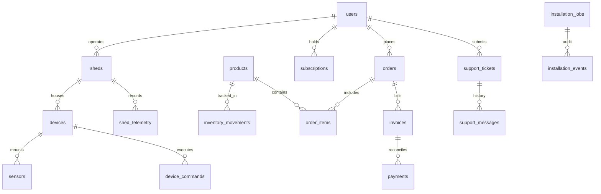

# SeriCare / Setu Enterprise Database Schema Specification

This document provides the definitive data dictionary and relational schema architecture for the SeriCare Enterprise Platform on **PostgreSQL 15+ / 18+**.

## 1. Relational Entity Diagram

---

## 2. Table Data Dictionaries

### 2.1 `users`
Core identity directory supporting multi-tenant RBAC (Super Admin, CEO, Technician, Support Agent, Sales Operator, Farmer).

| Column | Type | Constraints | Description |
| :--- | :--- | :--- | :--- |
| `id` | VARCHAR(64) | PRIMARY KEY | Unique user identifier (e.g. `usr_admin`) |
| `username` | VARCHAR(64) | UNIQUE, NOT NULL | Unique platform login handle |
| `hashed_password` | VARCHAR(255) | NOT NULL | Bcrypt salted hash (rounds: 12) |
| `full_name` | VARCHAR(128) | NOT NULL | Farmer / Operator legal name |
| `phone` | VARCHAR(32) | NOT NULL | Contact & WhatsApp notification number |
| `preferred_language` | VARCHAR(8) | DEFAULT 'kn' | Language code (`en`, `kn`, `te`, `hi`, `ta`, `ml`) |
| `role` | VARCHAR(32) | DEFAULT 'farmer' | RBAC role (`superadmin`, `ceo`, `technician`, `support`, `sales`, `farmer`) |
| `farm_name` | VARCHAR(128) | NOT NULL | Operating farm or facility name |
| `region` | VARCHAR(128) | NOT NULL | Sericultural district / cluster (e.g. `Kolar Cluster`) |
| `shed_id` | VARCHAR(64) | REFERENCES sheds | Primary rearing shed association |
| `dfl_capacity` | VARCHAR(64) | NOT NULL | Disease Free Layings (DFL) egg capacity |
| `breed` | VARCHAR(128) | NOT NULL | Silkworm hybrid breed (e.g. `Double Hybrid FC1 x FC2`) |
| `is_active` | BOOLEAN | NOT NULL DEFAULT TRUE | Account state |
| `created_at` | TIMESTAMPTZ | NOT NULL | UTC creation timestamp |

### 2.2 `products` & `inventory_movements`
Enterprise hardware catalogue and immutable stock ledger.

| Column | Type | Constraints | Description |
| :--- | :--- | :--- | :--- |
| `id` | VARCHAR(64) | PRIMARY KEY | Product ID (`prod_gw_01`) |
| `sku` | VARCHAR(64) | UNIQUE, NOT NULL | Stock Keeping Unit (`SKU-GW-ESP32-E`) |
| `name` | VARCHAR(255) | NOT NULL | Equipment commercial name |
| `category` | VARCHAR(64) | NOT NULL | Category (`Gateways`, `Sensors`, `Climate Control`) |
| `price_minor_units` | INT | NOT NULL | Price in minor currency units (Paise: ₹1 = 100) |
| `currency` | VARCHAR(8) | DEFAULT 'INR' | ISO currency code |
| `stock_quantity` | INT | NOT NULL DEFAULT 0 | Real-time warehouse balance |
| `unit` | VARCHAR(32) | DEFAULT 'unit' | Quantity unit (`unit`, `pack`, `meter`) |
| `is_active` | BOOLEAN | NOT NULL DEFAULT TRUE | Catalogue availability |

**`inventory_movements`**: Records every stock change with `previous_quantity`, `quantity_change`, `new_quantity`, `movement_type` (`PURCHASE`, `SALE`, `ADJUSTMENT`), and `created_by` actor audit.

### 2.3 `orders`, `order_items`, `invoices` & `payments`
Commercial sales engine with explicit financial lifecycle enforcement.

- **Order Statuses**: `PENDING`, `PAYMENT_PENDING`, `PAID`, `PROCESSING`, `FULFILLED`, `CANCELLED`, `REFUNDED`.
- **Payment Verification**: Reconciled against provider transactions (e.g. Razorpay payment ID, UPI UTR). Card numbers are never stored in application tables.
- **Monetary Precision**: All currency amounts stored as integer minor units (`total_amount_minor_units`), eliminating floating point drift.

### 2.4 `shed_telemetry` & `shed_telemetry_partitioned`
Authoritative microclimate time-series telemetry.

- Partitioned monthly by `RANGE (time)` for multi-year high-throughput retention.
- Zero fake data: invalid or missing sensor values are flagged with explicit quality status (`GOOD`, `DEGRADED`, `STALE`, `DISCONNECTED`).

### 2.5 `support_tickets` & `support_messages`
Multi-tier customer support system with ticket priorities (`LOW`, `MEDIUM`, `HIGH`, `CRITICAL`) and statuses (`OPEN`, `ASSIGNED`, `IN_PROGRESS`, `WAITING_FOR_CUSTOMER`, `RESOLVED`, `CLOSED`).

### 2.6 `installation_jobs` & `installation_events`
Field engineering deployment tracker with mandatory checklist verification before job completion sign-off.
