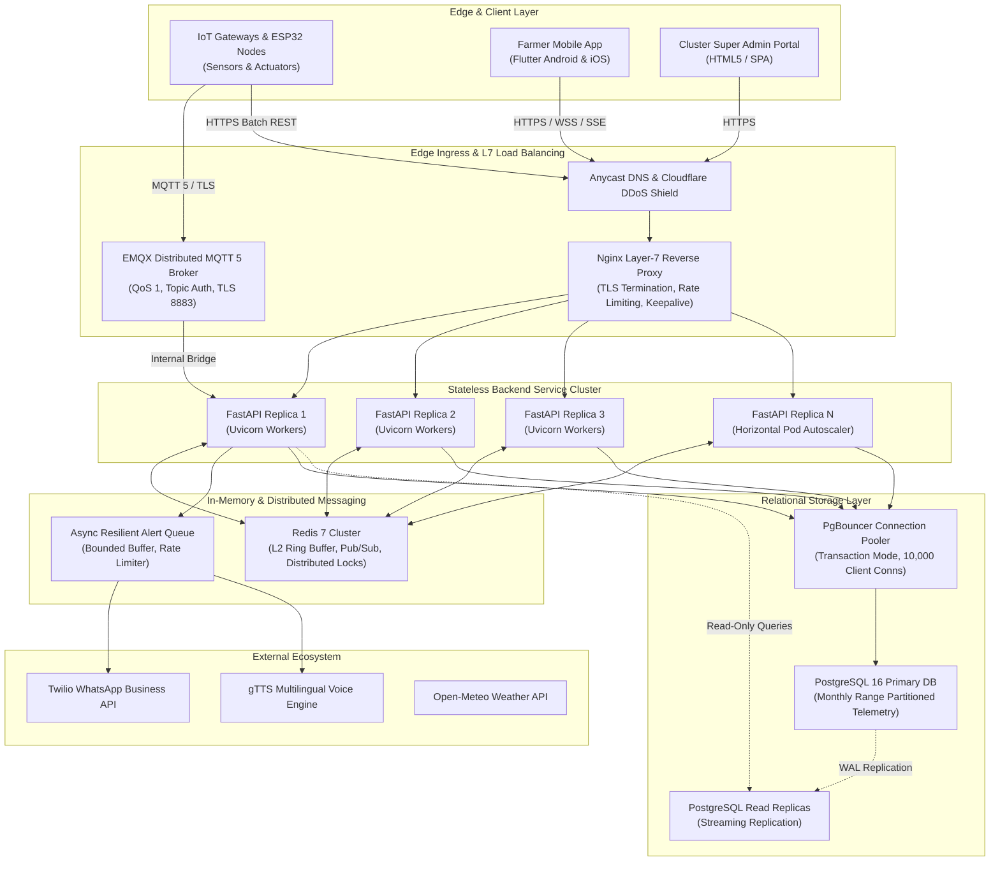

# SeriCare (Setu) — Enterprise Distributed Architecture Specification

## 1. Executive Summary & System Overview

SeriCare (Setu) is an enterprise-grade, distributed Internet of Things (IoT) precision sericulture automation platform. The platform monitors microclimatic environmental variables inside silkworm rearing sheds (temperature, relative humidity, air quality/CO2, illuminance), evaluates biological growth stages (1st Instar through 5th Instar), dispatches automated actuator controls (cooling, heating, ventilation fans, lighting, humidification), and delivers actionable farmer insights via mobile applications, an administrative web portal, and multilingual WhatsApp audio/text notifications.

To support high-concurrency scale-out toward **10,000,000 (1 crore) registered users and connected devices**, the architecture is designed around stateless application horizontal scaling, edge buffering, asynchronous message brokers, connection multiplexing, and transactional relational persistence.

---

## 2. Workload Separation & Service Boundaries

The platform enforces clean separation of concerns across core operational domains:

| Workload Domain | Primary Ingress Protocol | Concurrency Profile | Persistence Strategy |
| :--- | :--- | :--- | :--- |
| **Telemetry Ingestion** | MQTT 5 (`qos=1`), HTTPS Batch (`POST /telemetry/batch`) | Continuous, write-dominant, high throughput | L1 Ring Buffer $\rightarrow$ Batch execute_values into PostgreSQL Monthly Partitions |
| **Farmer Dashboard Reads** | HTTPS (`GET /sheds/{id}`), SSE (`GET /telemetry/sse/{id}`) | Burst-heavy, read-dominant, low latency | L1 Memory Cache (2s TTL) + Redis L2 cache, zero DB round-trips |
| **Actuator Command & Control**| HTTPS (`POST /control/commands`), MQTT Commands | Critical transactional integrity, audit logged | Immediate PostgreSQL ACID write with state machine (`REQUESTED` $\rightarrow$ `APPLIED`) |
| **Rules & Safety Interlock** | In-Process Event Evaluator | High frequency (per telemetry reading) | Pure in-memory rules engine; hysteresis & mutual exclusion |
| **Notifications & Voice** | Asynchronous worker queue | Burst-prone, external network bound | Bounded FIFO queue (`maxsize=10000`), rate-limited worker threads |
| **Historical Analytics** | HTTPS (`GET /telemetry/export/csv/{id}`) | Heavy read, long query duration | Partition-pruned sequential scan routed to Read Replica |

---

## 3. High Availability, Fault Tolerance & Autoscaling

1. **Stateless Backend Nodes**: All application instances run statelessly. Sessions and authentication are verified via cryptographic JWTs (`HS256` / `RS256`), eliminating server-side session stickiness requirements.
2. **Graceful Draining & Health Checks**:
   - `/health`: Liveness probe verifying process responsiveness.
   - `/ready`: Readiness probe verifying PostgreSQL pool connectivity and Redis ping.
   - Zero-downtime rolling deploys utilize a 15-second graceful connection draining period (`timeout http-keep-alive 65s`).
3. **Horizontal Pod Autoscaling (HPA)**:
   - Target metrics: CPU utilization $>70\%$, memory $>80\%$, or average request latency $>200\text{ms}$.
   - Scale-out rate: double replicas every 60 seconds during sudden microclimate emergency events.

---

## 4. Unified Authentication Gateway & Multi-Persona RBAC

The Setu platform replaces traditional fragmented or role-specific login interfaces with a unified authentication architecture:

`mermaid
sequenceDiagram
    autonumber
    actor User as User / Operator / Farmer
    participant Browser as Web Browser (Any Tab)
    participant Gateway as FastAPI Ingress (/api/v1/auth)
    participant AuthEngine as Session & Token Engine
    participant RBAC as Access Controller
    participant Postgres as PostgreSQL DB

    User->>Browser: Enters credentials on /login
    Browser->>Gateway: POST /api/v1/auth/login {username, password} (Headers: X-Tab-ID)
    Gateway->>Postgres: SELECT password hash, role, permissions, shed_id
    Gateway->>Gateway: Verify PBKDF2 hash (Constant-time comparison)
    Gateway->>AuthEngine: Generate session_id & short-lived JWT (HS256)
    AuthEngine->>Postgres: INSERT INTO user_sessions (session_id, user_id, tab_id, expires_at)
    Gateway-->>Browser: HTTP 200 {access_token, session_id, user}
    Browser->>Browser: Store credentials strictly in sessionStorage
    Browser->>RBAC: Query user.role default landing module
    RBAC-->>Browser: Route to role dashboard (e.g. overview, sheds, live-monitoring)
`

### Role-Authoritative Routing Matrix
Authentication never trusts a client-supplied role. The verified identity returned in the JWT determines the operational workspace:
- **superadmin / dmin**: Central Command & Platform Management (overview)
- **company_admin**: Organizations & Multi-Tenant Entities (organizations)
- **ceo**: Executive Analytics, Revenue & Cocoon KPIs (nalytics)
- **hr**: Human Resources, Department Hierarchy & Roster (employees)
- **operations_manager**: Regional Rearing Sheds & Batches Fleet (sheds)
- **	echnician**: Hardware Installation, IoT Provisioning & Offsets (installations)
- **sales**: Enterprise Hardware Catalogue, Orders & Billing (orders)
- **support**: Helpdesk Tickets, Resolution Queue & SLAs (support)
- **nalyst**: Sericultural Research Trends & Sensor Correlation (
esearch)
- **armer**: Silkworm Shed Microclimate Monitoring & Actuators (live-monitoring)

---

## 5. Per-Tab Independent Session Isolation Architecture

Browsers share cookies and localStorage across tabs in a single profile. To enable users to maintain distinct identities in separate tabs (e.g., Tab 1: Super Admin, Tab 2: Farmer Ramesh, Tab 3: Farmer Suresh), Setu implements an isolated tab session architecture:

`
[Browser Profile]
  ├── Tab 1 (Admin)     --> sessionStorage: setu_tab_id=tab_01, setu_tab_token=jwt_admin
  ├── Tab 2 (Farmer A)  --> sessionStorage: setu_tab_id=tab_02, setu_tab_token=jwt_farmerA
  └── Tab 3 (Farmer B)  --> sessionStorage: setu_tab_id=tab_03, setu_tab_token=jwt_farmerB
`

### Key Architectural Tenets:
1. **Isolated Storage (window.sessionStorage)**: Credentials, tokens, user records, and active navigation states are stored strictly in sessionStorage, which browsers isolate per tab. Shared storage (localStorage) is explicitly purged.
2. **Tab UUID Generation**: Each tab creates an unguessable UUID on initial boot (	ab_<crypto.randomUUID()>) retained for the lifespan of that tab.
3. **Transparent Fetch Interceptor**: Global window.fetch interceptor injects X-Tab-ID: tabId and X-Session-ID: currentSessionId into all outgoing HTTP requests.
4. **Independent Logout**: Logging out in Tab 1 revokes only Tab 1's session_id in PostgreSQL and blacklists its token in 
evoked_tokens. Tabs 2 and 3 remain authenticated and operational without interruption.
5. **Storage Event Quarantine**: A window.addEventListener('storage', ...) listener actively neutralizes any legacy cross-tab storage pollution events.
