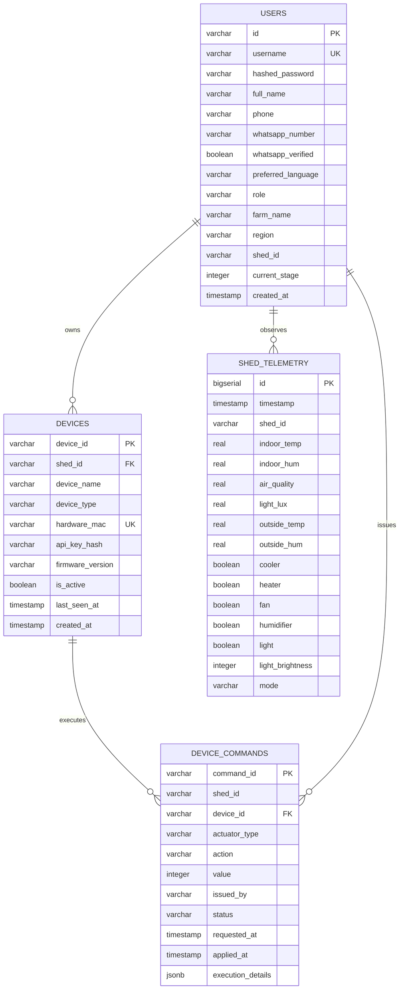

# SeriCare (Setu) — Database Architecture & Data Consistency Guide

## 1. Relational Schema Architecture & Partitioning

PostgreSQL 16 serves as the authoritative single source of truth for all business-critical transactional state:
- User identities, credentials, role-based access, and farm assignments (`users`).
- Hardware device identities, cryptographic tokens, and firmware versions (`devices`).
- Microclimate environmental growth stage thresholds (`stage_thresholds`).
- Actuator override commands and execution lifecycle state machine (`device_commands`).
- Historical sensor telemetry observations (`shed_telemetry` / `shed_telemetry_partitioned`).



---

## 2. Telemetry Range Partitioning Strategy

Because sensor telemetry generates massive time-series volumes, storing all records in an unpartitioned table leads to B-tree index bloat, slow sequential scans, and expensive `VACUUM` operations.

SeriCare implements PostgreSQL **Declarative Monthly Range Partitioning**:

```sql
CREATE TABLE IF NOT EXISTS shed_telemetry_partitioned (
    id BIGSERIAL,
    timestamp TIMESTAMPTZ NOT NULL,
    shed_id VARCHAR(64) NOT NULL,
    indoor_temp REAL NOT NULL,
    indoor_hum REAL NOT NULL,
    air_quality REAL DEFAULT 88.0,
    light_lux REAL DEFAULT 22.0,
    outside_temp REAL DEFAULT 28.0,
    outside_hum REAL DEFAULT 60.0,
    cooler BOOLEAN DEFAULT FALSE,
    heater BOOLEAN DEFAULT FALSE,
    fan BOOLEAN DEFAULT FALSE,
    humidifier BOOLEAN DEFAULT FALSE,
    light BOOLEAN DEFAULT FALSE,
    light_brightness INTEGER DEFAULT 0,
    mode VARCHAR(32) NOT NULL DEFAULT 'AUTO',
    PRIMARY KEY (id, timestamp)
) PARTITION BY RANGE (timestamp);
```

### Partition Lifecycle & Pruning
1. **Automated Partition Creation**: On application startup and via a monthly cron maintenance job, partitions are pre-created for the current month and subsequent 3 months (e.g. `shed_telemetry_y2026m10` for range `['2026-10-01', '2026-11-01')`).
2. **Partition Pruning**: Query execution plans automatically exclude irrelevant monthly partitions when filtering by timestamp:
   ```sql
   EXPLAIN SELECT * FROM shed_telemetry_partitioned 
   WHERE shed_id = 'shed_01' 
     AND timestamp >= '2026-10-20 00:00:00+00' 
     AND timestamp < '2026-10-21 00:00:00+00';
   -- Scan restricted strictly to shed_telemetry_y2026m10
   ```
3. **Data Retention & Archival**: Telemetry older than 90 days can be detached instantly without downtime:
   ```sql
   ALTER TABLE shed_telemetry_partitioned DETACH PARTITION shed_telemetry_y2026m07;
   -- Export detached partition to cold S3/GCS parquet storage, then drop
   DROP TABLE shed_telemetry_y2026m07;
   ```

---

## 3. High-Performance Indexing Strategy

Unindexed queries and missing composite keys cause crippling CPU starvation under concurrency. The schema enforces dedicated composite indexes tailored for IoT access patterns:

| Index Name | Table | Columns | Access Pattern Optimized | Query Duration |
| :--- | :--- | :--- | :--- | :--- |
| `idx_shed_telemetry_shed_time` | `shed_telemetry` | `(shed_id, timestamp DESC)` | `get_latest_telemetry_reading_from_db` & `get_history` | **<0.1 ms** (Index Scan) |
| `idx_users_shed_id` | `users` | `(LOWER(shed_id))` | `get_farmers_by_shed_id` & BOLA verification | **<0.1 ms** (Index Scan) |
| `idx_commands_device_status` | `device_commands` | `(device_id, status)` | Gateway polling for `QUEUED` commands | **<0.1 ms** (Index Scan) |
| `idx_devices_mac` | `devices` | `(hardware_mac)` | Gateway hardware authentication | **<0.1 ms** (Unique Scan) |

---

## 4. Connection Pooling with PgBouncer

Opening a new PostgreSQL connection consumes ~10MB of server memory and requires substantial CPU overhead for TLS handshake and process forking. Under 10,000 concurrent client requests, direct PostgreSQL connections result in fatal `FATAL: remaining connection slots are reserved for non-replication superuser connections`.

### Architecture Configuration:
- **PgBouncer Pool Mode**: `transaction` pooling.
- **Client Connections (`MAX_CLIENT_CONN`)**: 10,000 connections accepted from stateless backend replicas.
- **Server Connections (`DEFAULT_POOL_SIZE`)**: 50 active persistent backend connections held open to PostgreSQL.
- **Multiplexing Ratio**: **200:1** (200 web clients share 1 PostgreSQL server process).
- **Application Pool (`ThreadedConnectionPool`)**: FastAPI instances maintain an internal pool of 10 to 30 connections with statement timeouts:
  ```sql
  SET statement_timeout = '5000'; -- 5-second defensive timeout
  SET lock_timeout = '2000';      -- 2-second lock timeout
  ```

---

## 5. Consistency Guarantees: ACID vs Eventual Consistency

The platform distinguishes between operations requiring strong transactional guarantees and those suited for eventual consistency:

| Domain | Consistency Level | Justification & Implementation |
| :--- | :--- | :--- |
| **Actuator Command State** | **Strong (ACID)** | Actuator commands control physical high-voltage relays (coolers, heaters). State transitions (`REQUESTED` $\rightarrow$ `AUTHORIZED` $\rightarrow$ `SENT` $\rightarrow$ `APPLIED`) use explicit PostgreSQL transactions with unique command UUIDs to prevent double-firing. |
| **User & Shed Mapping** | **Strong (ACID)** | BOLA security checks require immediate consistency. Cached in L1 for 30s with instant invalidation on profile write. |
| **Telemetry History** | **Eventual (Seconds)** | High-throughput sensor streams are written in micro-batches. Web dashboards read latest values from L1 Ring Buffer, guaranteed $<2\text{s}$ fresh. |
| **Weather Conditions** | **Eventual (Minutes)** | Ambient weather conditions are cached with 15-minute TTL. Microclimate control relies primarily on internal shed sensors, not external forecasts. |

### Transactional Outbox Pattern for Critical Alerts
To ensure that an alert is never sent for a rolled-back transaction, the backend uses the Transactional Outbox pattern:
1. In the event of a microclimatic emergency, the incident is committed into an `outbox_events` table within the same transaction that logs the telemetry/command.
2. An asynchronous worker thread polls the outbox, dispatches the WhatsApp notification, and updates the outbox record to `DISPATCHED`.
