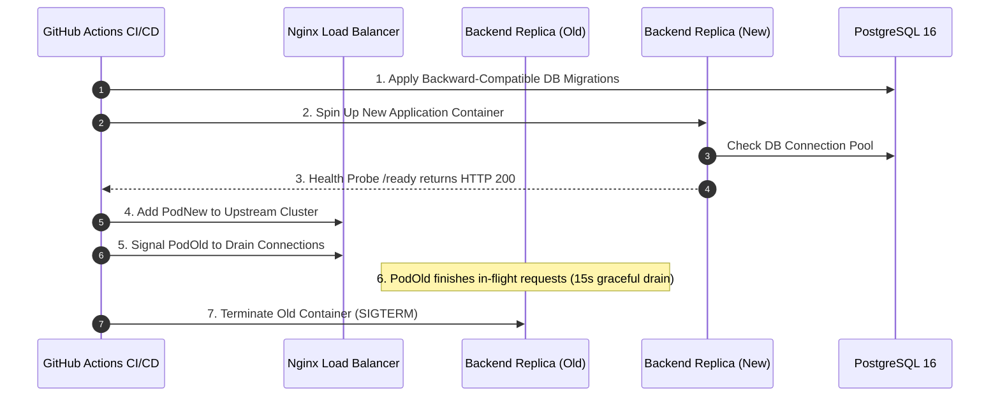

# SeriCare (Setu) — Production Deployment & SRE Operations Runbook

## 1. Zero-Downtime Deployment Procedure

Deploying updates to a live IoT platform that controls physical farm machinery requires zero-downtime rolling updates. Deployments must never drop in-flight telemetry batches or lose active actuator commands.



---

## 2. Step-by-Step Production Deployment Command Sequence

### Prerequisites
- Docker & Docker Compose v2 installed.
- PostgreSQL database reachable and initialized.
- Environment variables configured in `.env.production`.

### Step 1: Pre-Flight Verification
```bash
# Verify environment secrets are non-empty
test -n "$DATABASE_URL" && echo "DB configured"
test -n "$JWT_SECRET" && echo "JWT configured"

# Run automated test suite
python -m pytest backend/tests/ -v
```

### Step 2: Database Schema Migration
Ensure migrations are backward-compatible (e.g. adding columns with defaults, never dropping columns in the same deployment):
```bash
python -c "from app.services.db_service import init_db; init_db()"
```

### Step 3: Rolling Container Rebuild & Deployment
```bash
# Build updated application images
docker compose -f docker-compose.prod.yml build

# Rolling restart of backend replicas one by one
docker compose -f docker-compose.prod.yml up -d --no-deps --build backend_1
sleep 10
docker compose -f docker-compose.prod.yml up -d --no-deps --build backend_2
sleep 10
docker compose -f docker-compose.prod.yml up -d --no-deps --build backend_3
sleep 10
docker compose -f docker-compose.prod.yml up -d --no-deps --build backend_4
```

### Step 4: Post-Deployment Smoke Verification
```bash
# Verify cluster health
curl -f http://localhost/health
curl -f http://localhost/ready

# Verify Prometheus metrics exporter
curl -f http://localhost/metrics | grep setu_active_connections
```

---

## 3. Production Health Probes & Monitoring Metrics

The backend exposes three standardized SRE observability endpoints:

1. `GET /health`: Liveness probe. Returns HTTP 200 `{"status": "healthy"}` if event loop is unblocked.
2. `GET /ready`: Readiness probe. Returns HTTP 200 `{"status": "ready", "database": "connected"}` only when the PostgreSQL connection pool is verified and operational.
3. `GET /metrics`: Prometheus plain-text exporter providing:
   - `setu_requests_total{endpoint, status}`
   - `setu_active_connections`
   - `setu_queue_depth`
   - `setu_process_cpu_percent`
   - `setu_process_memory_mb`

---

## 4. Operational Incident Runbooks

### Incident 1: WhatsApp Queue Saturation (`setu_queue_depth > 5000`)
- **Symptoms**: Monitoring alert `WhatsAppQueueBacklogHigh` fires; delayed alert delivery to farmers.
- **Root Cause**: Upstream Twilio API degradation or rate-limiting.
- **Action**:
  1. Inspect worker logs:
     ```bash
     docker logs setu_backend_1 | grep "WhatsApp"
     ```
  2. If upstream 429 rate limits are active, temporarily enable dry-run mode to drop backlog without blocking telemetry ingestion:
     ```bash
     docker exec setu_backend_1 python -c "from app.services.whatsapp_alerts import alert_service; alert_service._dispatch_queue.queue.clear()"
     ```

### Incident 2: High Database Connection Usage (`PgBouncer Connections > 80%`)
- **Symptoms**: Increased latency on `GET /sheds/{id}`.
- **Root Cause**: Unindexed query or transaction lock contention.
- **Action**:
  1. Inspect active PostgreSQL queries:
     ```sql
     SELECT pid, now() - pg_stat_activity.query_start AS duration, query, state 
     FROM pg_stat_activity 
     WHERE state != 'idle' ORDER BY duration DESC LIMIT 5;
     ```
  2. Terminate long-running lock blocking queries if necessary:
     ```sql
     SELECT pg_terminate_backend(blocking_pid);
     ```
  3. Verify statement timeouts (`5000ms`) are active.
