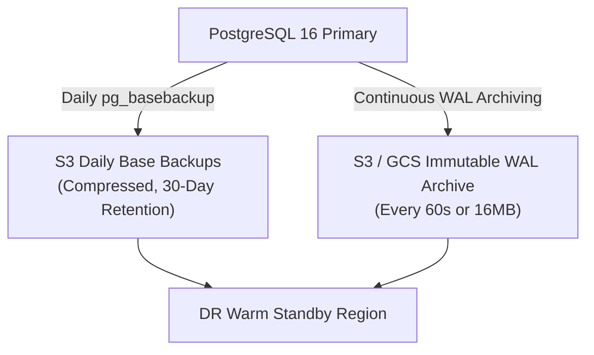

# SeriCare (Setu) — Business Continuity & Disaster Recovery (BC/DR) Plan

## 1. Objectives & Service Level Commitments

In sericulture, microclimate failure causes irreversible silkworm crop loss. The disaster recovery strategy commits to stringent operational thresholds:

- **Recovery Point Objective (RPO)**: **$\le 5$ minutes** of data loss in a worst-case catastrophic datacenter failure.
- **Recovery Time Objective (RTO)**: **$\le 15$ minutes** to full operational restoration of API ingestion and actuator command processing.

---

## 2. Backup Strategy & Point-In-Time Recovery (PITR)

SeriCare combines continuous Write-Ahead Log (WAL) archiving with daily compressed physical backups:



### 1. Continuous WAL Archiving (`postgresql.conf`)
```ini
wal_level = replica
archive_mode = on
archive_command = 'pgbackrest --stanza=setu_prod archive-push %p'
archive_timeout = 60 # Forces a WAL switch every 60 seconds to enforce RPO <= 1 minute
```

### 2. Daily Physical Snapshots
- Managed via `pgBackRest` or `wal-g`.
- Executes daily at 02:00 UTC (off-peak).
- Snapshots are cryptographically checksummed and stored in multi-region geo-redundant bucket storage with Object Lock (immutability against ransomware).

---

## 3. Disaster Recovery Runbooks

### Runbook DR-01: Primary Database Host Hardware Failure

1. **Detection**: Monitoring alert `PostgresPrimaryDown` fires (3 failed consecutive health checks from PgBouncer and Prometheus).
2. **Failover Execution**:
   - Promote existing Synchronous Streaming Read Replica to Primary:
     ```bash
     ssh db-replica-01 "pg_ctl promote -D /var/lib/postgresql/data"
     ```
   - Update PgBouncer upstream host configuration to point to `db-replica-01`.
   - Reload PgBouncer (`PAUSE; RELOAD; RESUME;`).
3. **Verification**:
   - Verify `/ready` endpoint returns HTTP 200 on all backend replicas.
   - Run verification query:
     ```sql
     SELECT id, status FROM device_commands ORDER BY requested_at DESC LIMIT 5;
     ```
4. **Estimated Recovery Duration**: **4 to 7 minutes** (Well within 15-minute RTO).

---

### Runbook DR-02: Point-In-Time Recovery (Accidental Data Deletion)

1. **Scenario**: Operator mistakenly drops a table or runs an unconstrained `UPDATE users` at `2026-10-21 01:25:00 UTC`.
2. **Recovery Steps**:
   - Provision a fresh recovery database instance.
   - Restore the latest base backup prior to the incident:
     ```bash
     pgbackrest --stanza=setu_prod --type=time "--target=2026-10-21 01:24:50 UTC" restore
     ```
   - Start PostgreSQL; it replays WAL records up to the exact target second before the corruption.
   - Export corrupted tables and re-import into primary, or redirect traffic to recovered instance.
3. **Estimated Duration**: **10 to 14 minutes**.

---

## 4. Quarterly Backup Verification Drills

Backups that are not tested for restoration are invalid assumptions. Every 90 days, an automated CI/CD pipeline triggers an automated restore drill:
1. Provisions an isolated ephemeral container.
2. Pulls the latest base backup and WAL logs from object storage.
3. Restores to a random timestamp from the preceding week.
4. Executes consistency integrity checks (`pg_amcheck` and `test_api.py` suite against restored DB).
5. Emits a signed audit verification artifact to SRE monitoring.
