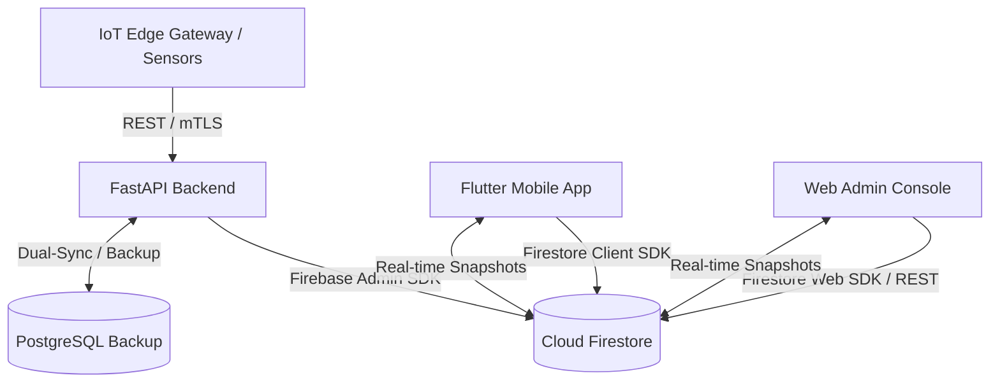

# SeriCare Firebase Cloud Firestore Database Architecture & Schema Specification

**Project ID:** `setu-a767c` (`setu-a767`)  
**Specification Version:** 1.0 (Production Migration)  
**Database Engine:** Google Cloud Firestore (Native Mode)  
**Last Updated:** October 2026  

---

## 1. Executive Architecture Summary

This document defines the authoritative NoSQL document schema for the migration of the SeriCare (Setu) Enterprise Platform from PostgreSQL 15+ to Firebase Cloud Firestore.

The Firestore database serves as the unified real-time data layer shared between:
1. **The Flutter Mobile Application (`mobile/`)** — Real-time telemetry monitoring, automated climate alerts, actuator controls, hardware ordering, and offline caching.
2. **The Web Application (`admin_web/`)** — Super Admin and Enterprise Platform Console, multi-tenant RBAC persona management, customer support, ERP, and inventory.
3. **The FastAPI Backend (`backend/`)** — High-throughput IoT telemetry ingestion, rules engine, SIEM auditing, WhatsApp alerts, and payment webhooks via the Firebase Admin SDK.



---

## 2. Collection & Document Mapping

| Relational Table (PostgreSQL) | Target Firestore Collection | Document ID Strategy | Subcollections / Embedded Objects |
| :--- | :--- | :--- | :--- |
| `users` | `users` | `user_id` (e.g. `usr_admin`, `usr_001`, or Firebase Auth UID) | `sessions` (optional subcollection) |
| `sheds` | `sheds` | `shed_id` (e.g. `shed_01`, `shed_02`) | Embedded current status, actuators, thresholds |
| `shed_telemetry` | `shed_telemetry` | Auto-ID or `tel_<shed_id>_<timestamp>` | Historical partitioned readings |
| `devices` | `devices` | `device_id` (e.g. `gw_esp32_01`) | Device metadata, connection status |
| `sensors` | `sensors` | `sensor_id` | Linked to `device_id` |
| `stage_thresholds` | `stage_thresholds` | `stage_<stage_id>` (e.g. `stage_1` to `stage_5`) | Master silkworm instar optimal envelopes |
| `shed_settings` | `shed_settings` | `shed_id` | Custom overrides per rearing shed |
| `device_commands` | `device_commands` | Auto-ID / `cmd_<uuid>` | Actuator override execution logs |
| `audit_logs` | `audit_logs` | Auto-ID / `log_<uuid>` | Immutable administrative audit trail |
| `products` | `products` | `product_id` (e.g. `prod_act_mist`) | Embedded `specifications`, `images` list |
| `inventory_movements` | `inventory_movements` | Auto-ID | Immutable stock ledger entries |
| `orders` | `orders` | `order_id` (e.g. `ORD-2026-0001`) | Embedded `items` array + reference |
| `order_items` | Embedded in `orders.items` | Array of item maps | Normalized inside order document |
| `invoices` | `invoices` | `invoice_id` | Linked to `order_id` and `user_id` |
| `payments` | `payments` | `payment_id` | Reconciled payment reference |
| `support_tickets` | `support_tickets` | `ticket_id` (e.g. `TKT-2026-001`) | Embedded `messages` list + subcollection |
| `support_messages` | `support_tickets/{ticketId}/messages` | Auto-ID / `msg_<id>` | Chronological conversation history |
| `installation_jobs` | `installation_jobs` | `job_id` | Field engineering tracker |
| `alerts` | `alerts` | Auto-ID / `alert_<id>` | Push & WhatsApp alert dispatches |
| `enquiries` | `enquiries` | Auto-ID / `enq_<id>` | CRM lead captures |
| `faqs` | `faqs` | `faq_id` | Public knowledge base |
| `guidance_articles` | `guidance_articles` | `article_id` | Silkworm rearing best practices |
| `organizations` | `organizations` | `organization_id` (e.g. `default_org`) | Tenant isolation boundary |
| `departments` | `departments` | `department_id` | Enterprise hierarchy |
| `roles` | `roles` | `role_id` | Role profiles with permission lists |
| `permissions` | `permissions` | `permission_code` | Granular capability codes |
| `employees` | `employees` | `employee_id` | Internal staff registry |
| `employee_invitations` | `employee_invitations` | `invitation_id` | Onboarding secure tokens |
| `user_sessions` | `user_sessions` | `session_id` | Active JWT session registry |
| `platform_settings` | `platform_settings` | `setting_key` | Global dynamic configuration |

---

## 3. Data Types & Storage Standards

1. **Timestamps**: Stored strictly as **Firestore `Timestamp`** instances (UTC). When serialized over JSON APIs, converted to standard ISO-8601 strings (`2026-10-29T11:15:00.000000+00:00`).
2. **Numeric Precision**:
   - Temperature (°C), Humidity (%), Air Quality Index, Light (Lux): Stored as 64-bit IEEE `double` numbers.
   - Financial Amounts: Stored as 64-bit integer minor currency units (`price_minor_units`, `total_amount_minor_units` in Paise: ₹1.00 = 100), eliminating floating-point rounding errors.
   - Stage IDs and Instars: Stored as 64-bit integers.
3. **Strings**: Clean UTF-8 strings. Nullable fields are either set to `null` or omitted to reduce document storage.
4. **Booleans**: Stored as native Firestore booleans (`true` / `false`).
5. **Enums**: Stored as uppercase strings (e.g. status: `"PAID"`, `"PENDING"`, `"IN_STOCK"`).
6. **Arrays vs Subcollections**:
   - Small, bounded lists (e.g. `order.items` [1–10 items], `product.images` [1–5 URLs], `role.permissions` [10–50 strings]) are stored as **embedded arrays** within the parent document for atomic reads.
   - Unbounded, high-growth entities (e.g. `shed_telemetry`, `audit_logs`, `support_messages`) are stored in dedicated collections with indexed queries and pagination.

---

## 4. Key Collection Schemas

### 4.1 Collection: `users`
- **Path**: `users/{userId}`
- **Indexes**: `username` (ASC), `role` (ASC), `shed_id` (ASC)
```json
{
  "id": "usr_farmer_01",
  "username": "ramesh_farmer",
  "full_name": "Ramesh Gowda",
  "phone": "+91 98450 12345",
  "official_email": "ramesh.gowda@sericare.in",
  "role": "farmer",
  "farm_name": "Green Valley Sericulture Farm",
  "region": "Kolar Cluster",
  "shed_id": "shed_01",
  "dfl_capacity": "200 DFL",
  "breed": "Double Hybrid (FC1 x FC2)",
  "preferred_language": "kn",
  "is_active": true,
  "mfa_enabled": false,
  "access_scope": "SHED_ONLY",
  "organization_id": "default_org",
  "created_at": "2026-10-29T00:00:00.000Z",
  "updated_at": "2026-10-29T11:00:00.000Z"
}
```

### 4.2 Collection: `sheds`
- **Path**: `sheds/{shedId}`
- **Indexes**: `id` (ASC), `organization_id` (ASC)
```json
{
  "id": "shed_01",
  "name": "Shed 01 - Main Chawki Hub",
  "location": "Kolar Rearing Center",
  "current_stage": 3,
  "target_temp": 26.0,
  "target_humidity": 75.0,
  "organization_id": "default_org",
  "active_device_id": "gw_esp32_01",
  "actuators": {
    "cooler": true,
    "heater": false,
    "fan": true,
    "light": true,
    "light_brightness": 35
  },
  "created_at": "2026-10-29T00:00:00.000Z"
}
```

### 4.3 Collection: `shed_telemetry`
- **Path**: `shed_telemetry/{telemetryId}`
- **Composite Indexes**:
  - `shed_id` (ASC) + `timestamp` (DESC)
  - `shed_id` (ASC) + `data_quality` (ASC) + `timestamp` (DESC)
```json
{
  "id": "tel_shed_01_1793254000",
  "shed_id": "shed_01",
  "device_id": "gw_esp32_01",
  "timestamp": "2026-10-29T11:15:00.000Z",
  "indoor_temp": 26.2,
  "indoor_humidity": 80.0,
  "indoor_air_quality": 88.0,
  "indoor_light_lux": 22.0,
  "outside_temp": 34.2,
  "outside_humidity": 58.0,
  "cooler_active": true,
  "heater_active": false,
  "fan_active": true,
  "light_active": true,
  "light_brightness": 35,
  "target_temp": 26.0,
  "target_humidity": 80.0,
  "airflow_target": 50.0,
  "light_target": 35.0,
  "air_quality_target": 80.0,
  "light_lux_target": 25.0,
  "photoperiod_mode": "DAY",
  "overall_status": "IDEAL",
  "status_headline": "Ideal for Silkworms",
  "status_subline": "Everything is comfortable inside the shed.",
  "data_quality": "GOOD"
}
```

### 4.4 Collection: `products`
- **Path**: `products/{productId}`
- **Indexes**: `category` (ASC) + `publication_status` (ASC)
```json
{
  "id": "prod_act_mist",
  "sku": "SKU-ACT-MIST-4N",
  "name": "High-Pressure Ultrasonic Cold Mist Fogger",
  "slug": "high-pressure-ultrasonic-cold-mist-fogger",
  "category": "Smart Rearing Shed Control",
  "short_description": "Micro-droplet humidification unit maintaining 85–90% RH for 1st/2nd Instar Chawki worms without wet bed rot.",
  "description": "Generates ultra-fine 5–10 micron water aerosols that evaporate in ambient air without settling on mulberry leaves.",
  "price_minor_units": 899900,
  "currency": "INR",
  "stock_quantity": 19,
  "unit": "unit",
  "availability_status": "IN_STOCK",
  "publication_status": "PUBLISHED",
  "compatibility": "Setu Gateway Relay Port 1/2, Automated Humidity Rules Engine",
  "specifications": {
    "Operating Power": "230V AC @ 120W with internal DC driver",
    "Atomization Rate": "3.5 Litres per hour (4 piezoceramic heads)",
    "Droplet Particle Size": "5–10 microns (floating aerosol)"
  },
  "images": [],
  "created_at": "2026-10-29T02:57:33.000Z",
  "updated_at": "2026-10-29T11:00:00.000Z"
}
```

### 4.5 Collection: `orders`
- **Path**: `orders/{orderId}`
- **Composite Indexes**: `user_id` (ASC) + `created_at` (DESC)
```json
{
  "id": "ORD-2026-0001",
  "user_id": "usr_farmer_01",
  "status": "PROCESSING",
  "total_amount_minor_units": 899900,
  "currency": "INR",
  "shipping_address": "Green Valley Sericulture Farm, Kolar Cluster",
  "payment_method": "UPI",
  "notes": "Urgent delivery before 3rd instar moult",
  "items": [
    {
      "product_id": "prod_act_mist",
      "product_name": "High-Pressure Ultrasonic Cold Mist Fogger",
      "quantity": 1,
      "price_minor_units": 899900
    }
  ],
  "created_at": "2026-10-29T03:00:00.000Z",
  "updated_at": "2026-10-29T03:05:00.000Z"
}
```

### 4.6 Collection: `stage_thresholds`
- **Path**: `stage_thresholds/{stageId}`
```json
{
  "stage_id": 3,
  "stage_name": "3rd Instar",
  "duration_days": "Days 7–9",
  "target_temp_min": 25.0,
  "target_temp_max": 26.0,
  "target_humidity_min": 75.0,
  "target_humidity_max": 80.0,
  "target_airflow": 1.0,
  "target_light_hours": 12.0,
  "target_light_lux": 20.0,
  "description": "Active feeding phase: worms start growing rapidly.",
  "created_at": "2026-10-29T00:00:00.000Z"
}
```

---

## 5. Security & Tenant Isolation Rules Summary

1. **Unauthenticated Access**:
   - `products`: Allowed to read `PUBLISHED` products.
   - `faqs`: Allowed to read all.
   - All other collections: **DENIED by default**.
2. **Farmer Role**:
   - `users`: Can only read/update their own document (`request.auth.uid == userId`).
   - `sheds`: Can only read/update sheds where they are the owner/operator.
   - `shed_telemetry`: Can read telemetry where `shed_id == user.shed_id`.
   - `orders`: Can create orders and view orders where `user_id == request.auth.uid`.
3. **Privileged Roles (Admin, Technician, Support)**:
   - Evaluated via token custom claims (`request.auth.token.role`) or employee record lookup.
   - Audit logs are append-only.

---

## 6. Access Pattern Optimization

- **Mobile Dashboard**: Single listener on `sheds/{shedId}` and query `shed_telemetry.where('shed_id', '==', shedId).orderBy('timestamp', 'desc').limit(1)` gives immediate zero-latency updates whenever IoT sensor nodes push data.
- **Storefront**: Single cached query on `products.where('publication_status', '==', 'PUBLISHED')`.
- **Historical Charting**: Cursor-based pagination on `shed_telemetry` using `startAfterDocument()`.
