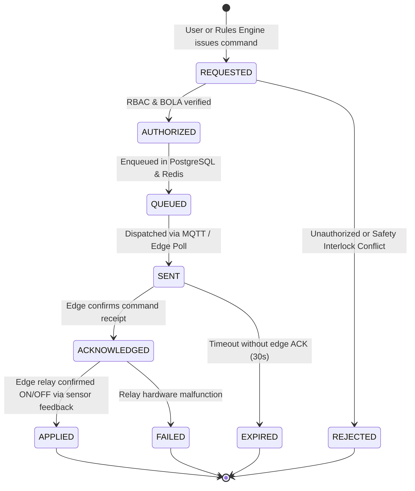

# SeriCare (Setu) — IoT Telemetry & Command Protocol Specification

## 1. Overview & Protocol Taxonomy

SeriCare supports dual-path ingestion and control:
1. **MQTT 5 via TLS 8883**: High-performance, persistent bidirectional streaming for resource-constrained ESP32 edge gateways and telemetry nodes.
2. **HTTPS REST API**: Standardized JSON fallback for gateways behind restrictive corporate firewalls (`POST /api/v1/telemetry/record` and `POST /api/v1/telemetry/batch`).

---

## 2. MQTT 5 Topic Architecture

Topic hierarchies follow strict tenant-isolated naming conventions:

```
organizations/{organization_id}/devices/{device_id}/telemetry
organizations/{organization_id}/devices/{device_id}/status
organizations/{organization_id}/devices/{device_id}/commands
organizations/{organization_id}/devices/{device_id}/command-acks
```

### Topic Definition & QoS Rules

| Topic Path | Direction | MQTT QoS | Payload Purpose |
| :--- | :--- | :--- | :--- |
| `.../telemetry` | Device $\rightarrow$ Cloud | **QoS 0 or 1** | Routine sensor readings (Temp, Hum, AQI, Lux). Periodic 30s frequency. |
| `.../status` | Device $\rightarrow$ Cloud | **QoS 1** (Retained) | Device connectivity, heartbeat, firmware version, IP, RSSI signal strength. Last Will and Testament (LWT) topic. |
| `.../commands` | Cloud $\rightarrow$ Device | **QoS 1** | Actuator state overrides (Heater ON, Cooler OFF, Fan speed). Must be acknowledged. |
| `.../command-acks`| Device $\rightarrow$ Cloud | **QoS 1** | Edge gateway execution acknowledgement with timestamp and hardware telemetry. |

---

## 3. Telemetry Event Schema

Every ingested telemetry event contains complete contextual metadata:

```json
{
  "event_id": "9b1deb4d-3b7d-4bad-9bdd-2b0d7b3dcb6d",
  "organization_id": "org_karnataka_seri",
  "shed_id": "shed_01",
  "device_id": "esp32_gateway_01",
  "sequence_number": 14205,
  "measured_at": "2026-10-21T01:35:00.120Z",
  "received_at": "2026-10-21T01:35:00.185Z",
  "temperature": 26.85,
  "humidity": 78.4,
  "air_quality": 92.0,
  "light_lux": 24.5,
  "firmware_version": "v2.4.1",
  "schema_version": "1.1",
  "quality_status": "GOOD"
}
```

### Sequence Gap Detection & Duplicate Elimination
1. **Idempotency Key**: The `event_id` UUID is indexed with a unique constraint in the partitioned database. Ingesting duplicate events results in a silent `ON CONFLICT DO NOTHING`.
2. **Sequence Gap Detection**: Devices maintain a monotonically increasing `sequence_number`. If the server detects `current_seq > last_seq + 1`, a gap alert is recorded in audit metrics, signaling dropped packets or local edge buffering recovery.
3. **Clock-Drift Handling**: If $| \text{measured\_at} - \text{server\_time} | > 300\text{s}$, the event is tagged with `quality_status = "CLOCK_DRIFT"` to protect historical time-series analytics from incorrect client RTC clocks.

---

## 4. Actuator Command Lifecycle State Machine

Actuator controls operate physical high-current relays connected to heaters, evaporative cooling pads, and exhaust fans. Mismanaged commands can cause thermal shock or silkworm mortality. Commands adhere to a strict 6-phase state machine:



### Safety Interlock Rules Enforced by Rules Engine:
- **Mutual Exclusion**: Heating and Cooling can **NEVER** run simultaneously. If Cooling is activated, Heating is forcibly disabled before the new command is authorized.
- **Minimum Cycle Time**: Actuators enforce a 60-second minimum dwell time to prevent compressor cycling and relay contact degradation.
- **Fail-Safe Default**: If an edge gateway loses connectivity for $>120\text{s}$, hardware firmware automatically engages default safe ventilation mode (Fans 50%, Coolers/Heaters OFF).

---

## 5. Offline Edge Buffering & Resilient Reconnection

Edge gateways (e.g. ESP32, Raspberry Pi Zero) support offline buffering:
1. When Wi-Fi/cellular backhaul drops, readings are appended to an on-board SPI Flash circular ring buffer (up to 10,000 readings).
2. Upon reconnection, the gateway negotiates an MQTT persistent session (`clean_start=false`) or uploads buffered records in batched chunks of 50 events to `POST /api/v1/telemetry/batch`.
3. The server ingests the batch in a single database transaction via `execute_values`, maintaining original `measured_at` timestamps.
