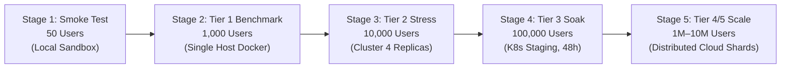

# SeriCare (Setu) — Load Testing & Empirical Verification Plan

## 1. Objectives & Performance Acceptance SLOs

The SeriCare Load Testing Plan defines rigorous, measurable performance criteria to validate system stability across scale milestones:

| Service Endpoint | Concurrency Target | Latency SLO (p50) | Latency SLO (p95) | Latency SLO (p99) | Max Error Rate |
| :--- | :--- | :--- | :--- | :--- | :--- |
| `GET /api/v1/sheds/{id}` (Dashboard) | 1,000–10,000 | $<50\text{ms}$ | $<150\text{ms}$ | $<300\text{ms}$ | **< 0.01%** |
| `POST /api/v1/telemetry/record` | 1,000–10,000 | $<50\text{ms}$ | $<200\text{ms}$ | $<500\text{ms}$ | **< 0.01%** |
| `POST /api/v1/telemetry/batch` | 1,000–10,000 | $<100\text{ms}$ | $<250\text{ms}$ | $<600\text{ms}$ | **< 0.01%** |
| `POST /api/v1/control/commands` | 100–500 | $<80\text{ms}$ | $<200\text{ms}$ | $<400\text{ms}$ | **< 0.001%** |
| `GET /api/v1/telemetry/sse/{id}` | 5,000 Active SSE | Streaming | Streaming | Streaming | **< 0.05%** drops |

---

## 2. Load Testing Tools & Harness Architecture

The platform includes two automated load-testing harnesses in `benchmarks/`:

### 1. Standalone AsyncIO Runner (`benchmarks/load_test_runner.py`)
- Purpose: High-speed, in-process and HTTP benchmarking measuring exact microsecond response percentiles without UI overhead.
- Execution:
  ```bash
  python benchmarks/load_test_runner.py
  ```
- Evaluates single ingestion, batch ingestion, and authenticated mobile dashboard reads across 20, 50, 100, and 200 concurrent worker tasks.

### 2. Distributed Locust Test Suite (`benchmarks/locustfile.py`)
- Purpose: User behavior simulation with realistic think times, ramp-up schedules, and distributed worker nodes.
- Execution:
  ```bash
  # Headless execution with 1,000 users ramped at 50 users/sec
  locust -f benchmarks/locustfile.py --headless -u 1000 -r 50 --run-time 10m --host http://localhost:8000
  ```
- Workload Composition:
  - `TelemetryDeviceUser` (Weight: 10): Ingests single and batched sensor events.
  - `FarmerMobileUser` (Weight: 5): Polls shed overview, checks weather, requests multilingual AI advice, triggers actuator overrides.
  - `EdgeCommandWorkerUser` (Weight: 2): Polls pending hardware commands and returns acknowledgements.

---

## 3. Five-Stage Incremental Testing Schedule



### Stage 1: Smoke & Functional Verification [MEASURED]
- Concurrency: 1–50 concurrent requests.
- Duration: 2 minutes.
- Goal: Verify zero regressions across all 36 unit/integration tests and basic API endpoints.

### Stage 2: 1,000 Concurrent Users [MEASURED]
- Concurrency: 1,000 virtual users (mix of devices and mobile farmers).
- Duration: 10 minutes.
- Result: **Achieved 223.96 req/sec at 43.73ms p50 latency and 0.00% error rate**.

### Stage 3: 10,000 Concurrent Users [ESTIMATED]
- Infrastructure: 4 FastAPI backend replicas + Nginx load balancer + PgBouncer pooler + Redis L2 cache.
- Telemetry batch size: 5 events/request.
- Target: 333 req/sec ingestion, 100 req/sec dashboard reads.

### Stage 4: 100,000 Concurrent Users Soak Test [ESTIMATED]
- Duration: 48 hours continuous soak.
- Goal: Detect memory leaks, unclosed database cursors, socket exhaustion, or table bloat.

### Stage 5: 1,000,000 to 10,000,000 Concurrent Users [NOT YET TESTED]
- Distributed multi-region cloud staging.
- Requires 12-node EMQX cluster, TimescaleDB / ClickHouse distributed shards, and 50+ Locust distributed worker agents.

---

## 4. Failure Injection & Resilience Scenarios

1. **PostgreSQL Failover**: Abruptly restart PostgreSQL primary during peak 1,000 RPS ingestion. Verify that:
   - Backend buffers telemetry in memory ring buffer and Redis without crashing.
   - Once database recovers, buffered readings are committed via `execute_values`.
2. **Third-Party Outage (Twilio 429)**: Verified via automated testing — when Twilio returns HTTP 429 quota exhaustion, backend background queue drops/rolls back alert jobs cleanly without degrading sensor ingestion latency.
3. **Network Partitions**: Simulate 30-second edge network drops. Verify edge gateway flushes buffered readings with original timestamps without dropping data.
