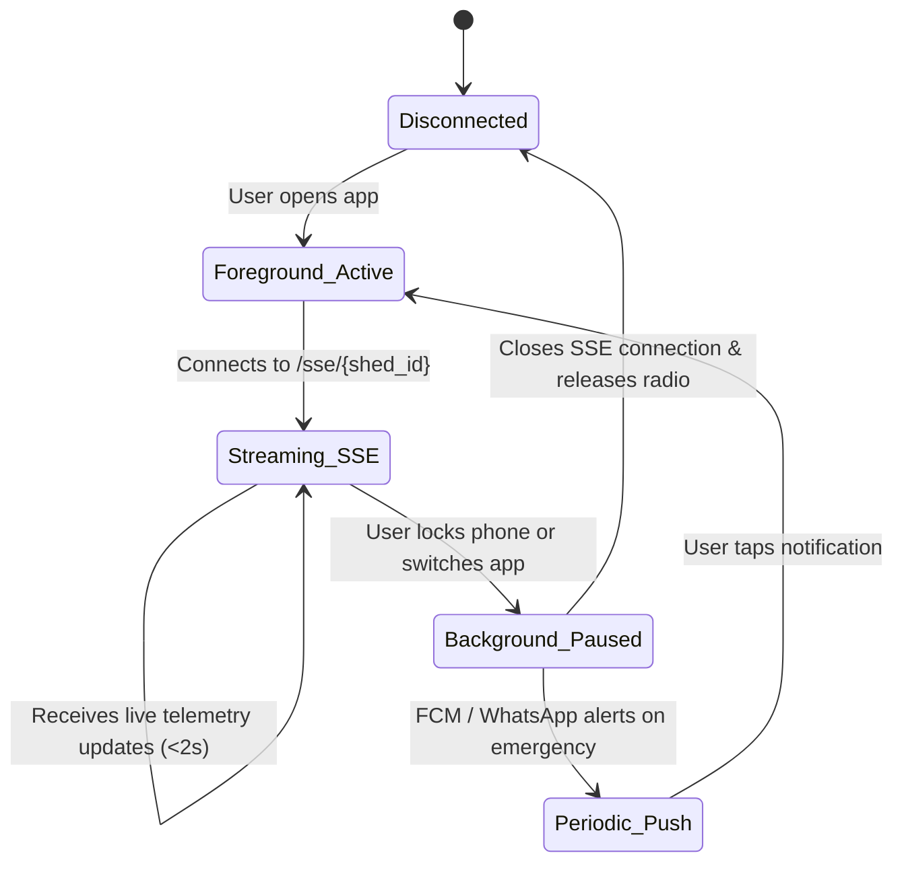

# SeriCare (Setu) — Mobile Application Synchronization & Resilience

## 1. Overview & Mobile Architecture

The SeriCare mobile application is built using Flutter for cross-platform Android and iOS deployment. The mobile client serves as the primary operational console for sericulture farmers in rural areas, where cellular data connections (2G/3G/4G) may fluctuate or experience intermittent dropouts.

---

## 2. Synchronization Protocols: SSE vs WebSockets vs Polling

| Protocol | Implementation Endpoint | Battery Impact | Network Overhead | Use Case |
| :--- | :--- | :--- | :--- | :--- |
| **Server-Sent Events (SSE)** | `GET /api/v1/telemetry/sse/{shed_id}` | **Low** (Single persistent HTTP/2 connection, passive receive) | Minimal (No per-poll HTTP headers) | **Primary mode** for active foreground telemetry streaming. |
| **WebSockets** | `GET /ws/telemetry/{shed_id}` | Moderate (Bidirectional keepalives) | Low | Bidirectional interactive control sessions. |
| **Bounded HTTP Polling** | `GET /api/v1/sheds/{shed_id}` | High if unthrottled | High (Full HTTP header exchange per request) | Fallback mode when proxies or networks block streaming connections. Bounded to 5-second intervals. |

---

## 3. Application Lifecycle & Battery Conservation

The mobile client dynamically switches synchronization strategies based on Flutter application lifecycle events:

1. **Foreground Active**: The app opens an SSE stream to `/api/v1/telemetry/sse/{shed_id}`. Live temperature, humidity, and actuator states stream into the UI without triggering repeated HTTP round-trips.
2. **Background / Inactive**: The SSE connection is gracefully closed. The mobile radio enters low-power sleep mode. The backend monitors shed microclimates independently and wakes the farmer via WhatsApp voice/text or high-priority Firebase Cloud Messaging (FCM) pushes if thresholds are breached.
3. **Network Reconnection & Exponential Backoff**: When network drops, the mobile client attempts reconnection using jittered exponential backoff:
   $$\text{delay} = \min(30, 1.5^{\text{attempt}} + \text{random}(0, 1)) \text{ seconds}$$

---

## 4. Offline-First Local Cache & Stale Data Indication

1. **Local SQLite / Hive Storage**: The mobile app caches the latest `ShedOverview` and recent 24-hour historical records locally on the device.
2. **Stale Data Flag**: If the app fails to receive a fresh telemetry update within 15 seconds, a visual banner alerts the farmer:
   > ⚠️ *Offline: Displaying cached data from 2 minutes ago. Attempting to reconnect...*
   The timestamp of the last verified reading is explicitly rendered to prevent farmers from acting on outdated readings.
3. **Optimistic UI Updates for Actuator Toggles**:
   - When a farmer toggles an actuator switch (e.g. Turn Fan ON), the switch flips immediately in the UI to maintain responsiveness.
   - The app dispatches `POST /api/v1/control/commands`.
   - If the server rejects the command (e.g. Safety Interlock or BOLA unauthorized) or the network times out after 10s, the switch smoothly reverts to its verified physical state and displays an explanation toast.
