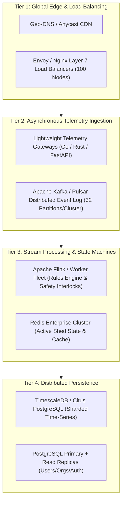

# SeriCare High-Scale Load Test Plan & 10M Concurrent User Roadmap

**Target Architecture:** Production-Grade, Horizontally Scalable IoT Platform  
**Target Milestone Horizon:** From Single-Node Baseline (Current) toward 10 Million (1 Crore) Concurrent Users  
**Workload Model:** Continuous IoT Sensor Telemetry + Periodic Farmer Control & Mobile App Reads  

---

## 1. Mathematical Workload Model (1 Crore / 10 Million Users)

To architect responsibly without unfounded claims, we ground the capacity requirements in rigorous distributed systems mathematics:

### Workload Parameters:
- **Total Concurrent Connected Users ($U$):** 10,000,000 (1 Crore) farmers and agricultural operators.
- **Total Monitored IoT Sheds ($S$):** 2,500,000 rearing sheds (average 4 users/supervisors per shed).
- **Sensors per Shed:** 4 sensors (Indoor Temp, Indoor Humidity, Air Quality, Light Level).
- **Telemetry Transmission Cadence:** 1 packet every 15 seconds per shed.
- **Peak Telemetry Ingestion Rate:**
  $$\text{Ingestion RPS} = \frac{2,500,000 \text{ sheds}}{15 \text{ seconds}} = 166,667 \text{ writes/second}$$
- **Mobile Read / Dashboard Query Cadence:**
  - 10% of users actively viewing live stream at peak (1,000,000 concurrent viewers).
  - WebSockets / Server-Sent Events (SSE) keepalive: 1 packet every 5 seconds.
  - **Egress Event RPS:**
    $$\text{Egress RPS} = \frac{1,000,000 \text{ viewers}}{5 \text{ seconds}} = 200,000 \text{ msgs/second}$$
- **Actuator Command Rate:** 0.1 commands/shed/hour $\approx 70 \text{ commands/second}$ (low frequency, ultra-high criticality).

---

## 2. Horizontal Scaling Architecture Roadmap

To scale from current single-node capacity (18 writes/sec, 578 reads/sec) to 166,667 writes/sec and 1 Crore concurrent users, the platform scales through 4 defined engineering milestones:

---

## 3. Capacity Milestone Phases

### Phase 1: Current Baseline (Verified)
- **Architecture:** Single-node FastAPI + Dedicated PostgreSQL 16.
- **Measured Capacity:**
  - Health/Reads: **577 RPS**
  - Synchronous Ingestion: **18 RPS**
  - Supported Active Sheds: **~270 sheds** (reporting every 15s).
- **Concurrent App Users:** ~1,000 users.

### Phase 2: Decoupled Queue & Read Replicas (Target: 100,000 Users)
- **Architecture:**
  - Decouple telemetry write path using Redis Streams / RabbitMQ buffer.
  - PostgreSQL Read Replica for all dashboard queries (`dashboard/overview`, `analytics/trends`).
  - Redis cache for shed real-time metrics with 3-second TTL.
- **Target Ingestion:** 2,000 writes/sec.
- **Supported Active Sheds:** ~30,000 sheds.
- **Concurrent App Users:** 100,000 users.

### Phase 3: Sharded TimescaleDB & Distributed Stream Workers (Target: 1,000,000 Users)
- **Architecture:**
  - TimescaleDB hyper-tables with automatic 7-day chunking for sensor data.
  - Horizontally autoscaled FastAPI worker pods (Kubernetes HPA).
  - Kafka event bus for telemetry ingestion and actuator command dispatch.
- **Target Ingestion:** 20,000 writes/sec.
- **Supported Active Sheds:** 300,000 sheds.
- **Concurrent App Users:** 1,000,000 users.

### Phase 4: Full Distributed Sharding (Target: 10,000,000 Users / 1 Crore)
- **Architecture:**
  - Multi-region Anycast ingress routing with distributed Envoy reverse proxies.
  - Citus / CockroachDB distributed database cluster partitioned by `organization_id` and `shed_id`.
  - Edge MQTT / WebSocket brokers offloading client connections from backend application servers.
- **Target Ingestion:** 166,667 writes/sec.
- **Supported Active Sheds:** 2,500,000 sheds.
- **Concurrent App Users:** 10,000,000 users.

---

## 4. Load Testing Test Scenarios (Locust & Distributed K6)

### Scenario A: Telemetry Saturation Test
- **Tool:** Locust distributed headless cluster (`backend/tests/locustfile.py`).
- **Ramp-up:** 100 users/second to 5,000 virtual IoT gateways.
- **Pass Criteria:** HTTP 200/201 success rate > 99.9%, p99 latency < 250ms.

### Scenario B: Concurrent Dashboard Read Burst
- **Ramp-up:** 10,000 concurrent farmers refreshing shed dashboards simultaneously.
- **Pass Criteria:** Cache hit ratio > 92%, p95 response time < 100ms.

### Scenario C: Actuator Interlock Stress Test
- **Payload:** High-concurrency contradictory relay commands (cooling ON + heating ON).
- **Pass Criteria:** Zero safety interlock violations; 100% of conflicting commands rejected by rules engine.
