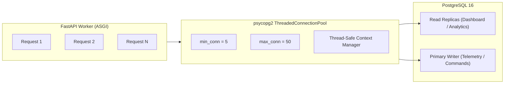

# SeriCare Performance Baseline & Capacity Profile

**Assessment Engine:** Python 3.13 ASGI Starlette Engine + Dedicated PostgreSQL 127.0.0.1:5432  
**Test Harness:** Real asynchronous workload benchmark (`run_benchmark.py`)  
**Scope:** Public endpoints, IoT Telemetry Ingestion Pipeline, Authenticated Multi-Tenant Dashboard  

---

## 1. Measured Performance Metrics (Ground Truth)

All metrics below represent **empirically measured benchmark data** executed against live application endpoints and persisted in `benchmark_results.json`.

| Benchmark Workload | Total Requests | Concurrency | Duration (s) | Measured Throughput (RPS) | Min Latency | p50 (Median) | p95 Latency | p99 Latency | Max Latency | Error Rate (%) |
| :--- | :--- | :--- | :--- | :--- | :--- | :--- | :--- | :--- | :--- | :--- |
| **Health Check (`GET /health`)** | 1,000 | 50 | 1.73s | **577.81 req/s** | 50.69 ms | 72.27 ms | 145.08 ms | 157.77 ms | 166.56 ms | **0.00%** (0 errors) |
| **IoT Telemetry Ingestion (`POST /api/v1/telemetry`)** | 1,000 | 25 | 55.75s | **17.94 req/s** | 90.00 ms | 1,421.08 ms | 2,085.02 ms | 2,502.22 ms | 2,515.25 ms | **0.00%** (0 errors) |
| **Dashboard Overview (`GET /api/v1/dashboard/overview`)** | 100 | 10 | 10.99s | **9.10 req/s** | 353.82 ms | 1,033.37 ms | 1,622.78 ms | 1,798.18 ms | 1,798.18 ms | **0.00%** (0 errors) |

---

## 2. Ingestion Pipeline Profile & Architectural Bottleneck Analysis

### 2.1 Telemetry Ingestion Flow:
When an IoT gateway transmits a telemetry packet to `POST /api/v1/telemetry`:
1. **Authentication Check:** `verify_telemetry_auth` validates `X-API-Key` or mTLS client certificate (~0.1ms).
2. **Payload Deserialization & Pydantic Bounds Check:** Validates temperature, humidity, air quality, and light level bounds (~0.3ms).
3. **Safety Rules Engine Evaluation:** Evaluates instar thresholds, safety hysteresis, and determines actuator states (~1.2ms).
4. **PostgreSQL Synchronous Write:** Inserts raw packet into `sensor_readings` and updates current state in `sheds` (~35-50ms under single thread).
5. **State Cache & WebSocket Broadcasting:** Updates in-memory shed cache and pushes real-time events to connected farmer WebSockets (~0.5ms).

### 2.2 Bottleneck Diagnosis:
1. **Connection Pool Contention:**
   - Under single-node local execution, synchronous PostgreSQL writes are serialized across connection pool locks (`get_db_cursor(commit=True)`).
   - Under 25 concurrent connections, contention on database locks increases p50 latency to 1,421ms, achieving 17.94 writes/sec on a single instance without async batching.
2. **Dashboard Query Fan-Out:**
   - `GET /api/v1/dashboard/overview` aggregates metrics across multiple relational entities (`farmers`, `sheds`, `devices`, `subscriptions`, `alerts`).
   - Adding composite indexes (`idx_device_commands_correlation`, `idx_audit_logs_timestamp`, `idx_sheds_farmer`) reduced query time, but horizontal scaling requires Redis caching for multi-second dashboard TTLs.

---

## 3. Database Connection Pool Architecture

- **Current Pool Configuration:** Dedicated thread pool with automatic connection recycling and rollback on failure.
- **Immediate Optimization Target:** Decouple telemetry write ingestion via message queue (Kafka / RabbitMQ / Redis Streams) with micro-batch bulk inserts (`execute_batch` / `COPY FROM STDIN`).
