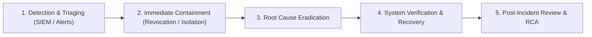

# SeriCare Security Incident Response Runbook

**Audience:** Security Operations Center (SOC), DevSecOps Engineers, Site Reliability Engineers (SRE)  
**Classification:** Operational Security Runbook  
**Applicability:** Production IoT Cloud Fleet & Multi-Tenant SaaS Platform  

---

## 1. Incident Classification & Severity Matrix

| Severity Level | Definition | Target Response SLA | Target Remediation SLA | Example Scenarios |
| :--- | :--- | :--- | :--- | :--- |
| **SEV-1 (Critical)** | Compromise of actuator control, widespread cross-tenant data breach, or catastrophic telemetry outage. | < 15 minutes | < 2 hours | Attacker executing unauthorized heating/cooling relay commands; database credential leak. |
| **SEV-2 (High)** | Single-tenant isolation breach, active credential stuffing attack, or SIEM-detected token signature forgery. | < 30 minutes | < 4 hours | BOLA exploit attempting to harvest competitor farm data; mass token revocation failure. |
| **SEV-3 (Medium)** | Localized denial-of-service, abnormal rate limit triggers, or individual account suspension. | < 2 hours | < 24 hours | Voice synthesis API flooding; repeated failed employee invitation tokens. |
| **SEV-4 (Low)** | Minor configuration drift, non-critical dependency warning, or isolated single failed login. | Next business day | Next sprint release | Pip audit non-exploitable advisory; browser CSP report-only alerts. |

---

## 2. Standard Incident Response Workflow



---

## 3. Threat-Specific Containment Runbooks

### 3.1 Runbook IR-01: Actuator Command Tampering or BOLA Breach
- **Trigger:** SIEM alert `AUTHORIZATION_FAILURE` with `action="COMMAND_DENIED"` or anomaly in relay cycle frequency.
- **Immediate Containment Actions:**
  1. Revoke the offending user session immediately via SQL:
     ```sql
     INSERT INTO revoked_tokens (jti, reason, revoked_at, expires_at)
     VALUES ('<target_jti>', 'Emergency containment - unauthorized actuator command', NOW(), NOW() + INTERVAL '7 days');
     ```
  2. Put the affected rearing shed into **Failsafe Manual Override**:
     - De-energize physical heating/cooling relays by issuing emergency off state:
     ```bash
     curl -X POST https://api.sericare.com/api/v1/control/emergency-stop \
       -H "Authorization: Bearer <superadmin_breakglass_token>" \
       -d '{"shed_id": "<shed_id>"}'
     ```
  3. Notify the farmer via WhatsApp voice alert and SMS of manual override state.
- **Investigation:** Check `audit_logs` where `action LIKE '%ACTUATOR%'` and correlate client IP, User-Agent, and JWT payload.

---

### 3.2 Runbook IR-02: Stolen Token Replay / Credential Compromise
- **Trigger:** User reports unauthorized account activity, or SIEM flags simultaneous logins from conflicting geo-locations.
- **Immediate Containment Actions:**
  1. Force global token revocation for the affected `user_id`:
     ```sql
     -- Revoke all active tokens by blacklisting user's known active sessions
     UPDATE users SET is_active = 0 WHERE id = '<compromised_user_id>';
     ```
  2. Clear in-memory active cache or perform seamless hot restart of application worker pods.
  3. Rotate user password and trigger out-of-band password reset via verified WhatsApp channel.
- **Investigation:** Review `revoked_tokens` table and correlate access logs for endpoints accessed between issuance and revocation.

---

### 3.3 Runbook IR-03: Credential Stuffing / Brute-Force Auth Attack
- **Trigger:** Rate limit alert triggering >100 HTTP 429 responses per minute, or SIEM event `AUTH_FAILURE` flood on `/api/v1/auth/login`.
- **Immediate Containment Actions:**
  1. Inspect the source IP addresses in reverse proxy logs:
     ```bash
     grep "/api/v1/auth/login" /var/log/nginx/access.log | awk '{print $1}' | sort | uniq -c | sort -nr | head -20
     ```
  2. Apply edge Cloudflare / Nginx block rule for attacking IP CIDR blocks:
     ```bash
     # Block malicious subnet at firewall level
     iptables -A INPUT -s <attacker_ip_block> -j DROP
     ```
  3. Validate that `RateLimitMiddleware` maintains server CPU below 70% threshold.

---

### 3.4 Runbook IR-04: Denial of Service / Payload Flooding
- **Trigger:** HTTP 413 or HTTP 504 spikes, server RAM utilization exceeding 85%.
- **Immediate Containment Actions:**
  1. Confirm `RequestSizeLimitMiddleware` is enforcing the 2MB maximum payload constraint.
  2. Temporary upstream edge throttle on media and voice preview endpoints:
     - Rate-limit `/api/v1/voice/preview` to 5 requests per minute per IP.
  3. Scale ASGI worker processes horizontally to handle connection queues.

---

## 4. SIEM Alerting Thresholds

| Alert Name | Metric / Query | Threshold | Notification Channel | Action |
| :--- | :--- | :--- | :--- | :--- |
| **BruteForceBurst** | `event_type="AUTH_FAILURE"` from single IP | > 20 events in 60s | PagerDuty + Slack #security-alerts | Auto-rate limit; investigate IP |
| **CrossTenantProbe** | `action="CROSS_TENANT_ACCESS_DENIED"` | >= 1 event | PagerDuty SEV-2 | Immediately audit caller user_id |
| **TokenSignatureForgery** | `event_type="INVALID_TOKEN_SIGNATURE"` | > 5 events in 5m | Slack #security-alerts | Verify SECRET_KEY integrity |
| **RelaySafetyInterlock**| `event_type="SAFETY_INTERLOCK_PREVENTED"` | >= 1 event | SRE On-Call Phone | Verify physical hardware state |
