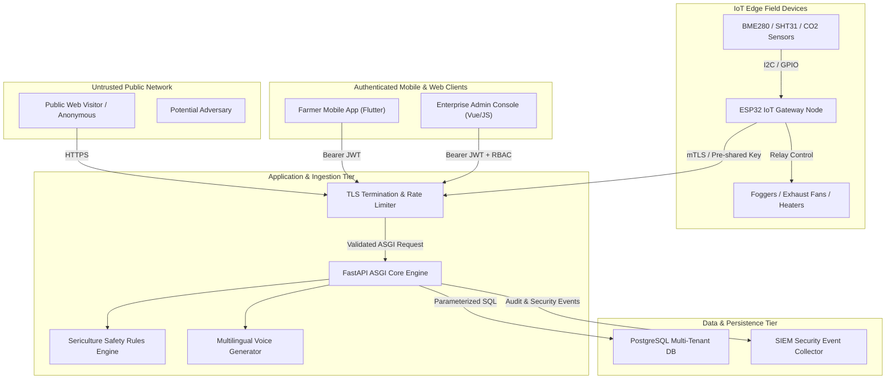

# SeriCare Threat Model & Attack Surface Analysis

**Methodology:** Microsoft STRIDE (Spoofing, Tampering, Repudiation, Information Disclosure, Denial of Service, Elevation of Privilege)  
**System Architecture:** Multi-tenant SaaS IoT Platform (Backend API, PostgreSQL, IoT Edge Nodes, Mobile Application, Cloud Admin Console)  
**Target:** Production Hardening & High-Consequence Physical Actuation Protection  

---

## 1. System Architecture & Trust Boundaries

The SeriCare platform operates across five primary trust zones:

### Trust Boundary Definitions:
1. **TB-1 (Internet Boundary):** Separates untrusted public clients from the reverse proxy and ASGI application.
2. **TB-2 (Client Authentication Boundary):** Separates unauthenticated traffic from authenticated farmer and administrator sessions.
3. **TB-3 (Multi-Tenant Boundary):** Separates organizational tenant data (Tenant Alpha vs. Tenant Beta) within shared database tables.
4. **TB-4 (IoT Ingestion Boundary):** Separates field telemetry and actuator command execution from internal services.
5. **TB-5 (Physical Hardware Boundary):** Separates software control logic from physical high-voltage relays (fans, heating coils, humidifiers).

---

## 2. STRIDE Threat Assessment & Mitigations

### 2.1 Spoofing (Identity Threats)
- **Threat S-1: Forged JWT Access Tokens:**
  - *Attack:* Adversary fabricates JWT tokens signed with default or compromised secret keys.
  - *Mitigation:* Cryptographic signature verification with minimum 256-bit entropy secrets. Production startup validator rejects default or short keys.
- **Threat S-2: Rogue IoT Gateway Impersonation:**
  - *Attack:* Rogue hardware transmits fraudulent sensor readings to cause improper shed temperature regulation.
  - *Mitigation:* `verify_telemetry_auth` validates hardware mTLS client certificates (ATECC608A) or pre-shared device secret keys before processing telemetry.

### 2.2 Tampering (Data Integrity Threats)
- **Threat T-1: Actuator Command Tampering:**
  - *Attack:* Adversary alters in-flight command payloads to trigger destructive heating/cooling.
  - *Mitigation:* Commands are cryptographically tracked via UUID correlation IDs and state transitions (`REQUESTED -> AUTHORIZED -> QUEUED -> SENT -> ACKNOWLEDGED -> APPLIED`).
- **Threat T-2: Database Parameter Manipulation:**
  - *Attack:* SQL injection payloads in user inputs or global search terms.
  - *Mitigation:* 100% psycopg2 parameterized query execution with bound tuples.

### 2.3 Repudiation (Audit Integrity Threats)
- **Threat R-1: Disavowal of Critical Administrative or Control Actions:**
  - *Attack:* Operator disables safety systems or modifies stage thresholds and denies taking action.
  - *Mitigation:* Immutable `audit_logs` table records actor, action, timestamp, and metadata. SIEM forwarder streams events to external monitoring.

### 2.4 Information Disclosure (Confidentiality Threats)
- **Threat I-1: Cross-Tenant Order and Ticket Harvesting:**
  - *Attack:* Authenticated Company Admin from Organization A accesses orders or support tickets of Organization B.
  - *Mitigation:* SQL joins enforce tenant organization filtering (`AND u.organization_id = %s`), returning HTTP 403 Forbidden on cross-tenant requests.
- **Threat I-2: AI Explainer Shed Telemetry Inference:**
  - *Attack:* Unauthorized farmer probes `/api/v1/ai/explain/{shed_id}` to deduce competitor shed environmental conditions.
  - *Mitigation:* `verify_shed_access` rejects requests when caller's assigned shed does not match target shed.

### 2.5 Denial of Service (Availability Threats)
- **Threat D-1: Voice Synthesis Memory & Compute Exhaustion:**
  - *Attack:* Attacker submits huge text strings to `/api/v1/voice/preview` to exhaust server CPU and RAM.
  - *Mitigation:* Pydantic schemas enforce `max_length=500` characters, rejecting oversized payloads with HTTP 422.
- **Threat D-2: Large Payload Flooding:**
  - *Attack:* Adversary streams multi-megabyte payloads to unauthenticated endpoints to exhaust socket buffers.
  - *Mitigation:* `RequestSizeLimitMiddleware` terminates requests with `Content-Length > 2MB` with HTTP 413.
- **Threat D-3: Credential Stuffing & Auth Brute Force:**
  - *Attack:* Automated scripts flood `/api/v1/auth/login`.
  - *Mitigation:* Sliding window rate limiter throttles clients exceeding 30 requests per minute with HTTP 429.

### 2.6 Elevation of Privilege (Authorization Threats)
- **Threat E-1: Farmer to Administrator Privilege Escalation:**
  - *Attack:* Farmer modifies user profile or role payload to gain `superadmin` privileges.
  - *Mitigation:* Role assignments are protected by `require_roles(["superadmin"])`. Circular reporting prevention blocks privilege hierarchy elevation.
- **Threat E-2: Session Replay After Account Suspension or Logout:**
  - *Attack:* Attacker intercepts or reuses an active JWT after user logout.
  - *Mitigation:* Token revocation table (`revoked_tokens`) blacklists token `jti` and token SHA-256 digests immediately upon logout.
