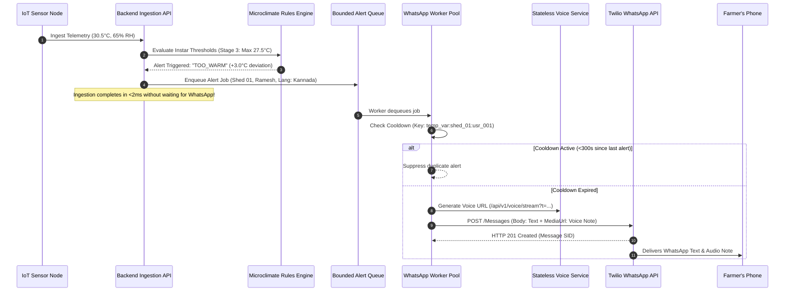

# SeriCare (Setu) — WhatsApp & Voice Notification Infrastructure

## 1. Overview & Notification Pipeline

SeriCare provides real-time emergency alerting to sericulture farmers via WhatsApp text messages and automated regional voice notes. Because sericulture farmers may be away from their sheds in agricultural fields without high-speed data access, voice-note delivery ensures critical microclimate alerts are understood immediately in the farmer's preferred native language (Kannada, Telugu, or English).



---

## 2. Multilingual Alert Templates & 1-Line Explanation

Alerts are formatted dynamically based on the farmer's registered `preferred_language`:

### Kannada (ಕನ್ನಡ) Alert Template
```
⚠️ ತೀವ್ರ ಎಚ್ಚರಿಕೆ - ಸೇತು ಮೈಕ್ರೋಕ್ಲೈಮೇಟ್
ರೈತರು: ರಮೇಶ್ ಗೌಡ (Shed 01)
ಶೆಡ್: SHED_01 (ಹಂತ: 3rd Instar)

ಪ್ರಸ್ತುತ ತಾಪಮಾನ: 30.5°C (ನಿರೀಕ್ಷಿತ: 26.0°C | ಗರಿಷ್ಠ: 27.5°C)
ಪ್ರಸ್ತುತ ಆರ್ದ್ರತೆ: 65% (ನಿರೀಕ್ಷಿತ: 75% | ಕನಿಷ್ಠ: 70%)
ಸ್ಥಿತಿ: TOO_WARM - ವಾತಾಯನ ಹಾಗೂ ಕೂಲಿಂಗ್ ಪ್ಯಾಡ್ ತಕ್ಷಣ ಆನ್ ಮಾಡಿ.

ಉಪಕರಣಗಳ ಸ್ಥಿತಿ: ಕೂಲರ್: ಆನ್ | ಹೀಟರ್: ಆಫ್ | ಫ್ಯಾನ್: ಆನ್

ವಿವರಣೆ: ತಾಪಮಾನವು 3.0°C ಹೆಚ್ಚಾಗಿದೆ. ಹುಳುಗಳ ಉಸಿರಾಟ ಸುಗಮಗೊಳಿಸಲು ಮತ್ತು ಶಾಖ ತಗ್ಗಿಸಲು ಕೂಲರ್ ಮತ್ತು ಫ್ಯಾನ್ ಆನ್ ಮಾಡಲಾಗಿದೆ.
```

### Telugu (తెలుగు) Alert Template
```
⚠️ అత్యవసర హెచ్చరిక - సేతు మైక్రోక్లైమేట్
రైతు: రమేష్ గౌడ (Shed 01)
షెడ్: SHED_01 (దశ: 3rd Instar)

ప్రస్తుత ఉష్ణోగ్రత: 30.5°C (లక్ష్యం: 26.0°C | గరిష్టం: 27.5°C)
ప్రస్తుత తేమ: 65% (లక్ష్యం: 75% | కనిష్టం: 70%)
స్థితి: TOO_WARM - వెంటిలేషన్ మరియు శీతలీకరణ వ్యవస్థను వెంటనే ప్రారంభించండి.

పరికరాల స్థితి: కూలర్: ఆన్ | హీటర్: ఆఫ్ | ఫ్యాన్: ఆన్

వివరణ: ఉష్ణోగ్రత 3.0°C పెరిగింది. పట్టుపురుగులను కాపాడటానికి కూలర్ మరియు ఎగ్జాస్ట్ ఫ్యాన్ ఆన్ చేయబడ్డాయి.
```

---

## 3. Stateless Voice Note Delivery Mechanism

1. **Stateless Audio Streaming**: Rather than saving hundreds of thousands of ephemeral `.mp3` audio files to local disk or cloud object storage, SeriCare implements a stateless streaming endpoint:
   ```
   GET /api/v1/voice/stream?text={base64_encoded_script}&lang={kn|te|en}
   ```
2. **On-The-Fly Audio Synthesis**:
   - The route receives the text, decodes it, synthesizes speech in memory via Google Text-to-Speech (`gTTS`), and streams the resulting `audio/mpeg` payload directly through `StreamingResponse`.
   - Twilio downloads the audio stream over HTTPS and delivers it to WhatsApp clients as a native playable voice note.
3. **Bandwidth Optimization**: Synthesized audio notes average 12–18 seconds in duration (~28 KB MP3 payload), minimizing cellular data overhead.

---

## 4. Rate Limiting, Cooldowns & Quota Protection

1. **Bounded Async Queue**: Alert jobs are buffered in `_dispatch_queue = queue.Queue(maxsize=10000)`. If WhatsApp providers experience upstream downtime, jobs are enqueued without consuming backend request threads. If the queue fills completely, non-critical alerts are dropped to prevent memory exhaustion.
2. **Cooldown Throttling (300 Seconds)**:
   - Cooldown key: `temp_var:{shed_id}:{farmer_id}`.
   - Once an alert is dispatched, subsequent readings from that shed within 5 minutes are suppressed to prevent spamming farmers.
3. **Provider Rate Limiting (20 MPS)**: The background worker pool paces outgoing requests with a 50ms inter-message interval, strictly complying with Twilio's 20 messages-per-second (MPS) API limits.
4. **Graceful 429 Handling**: If Twilio returns HTTP 429 (e.g. daily sandbox limit exceeded), the worker logs the incident cleanly, rolls back the cooldown timestamp to allow future delivery, and avoids crashing the background worker.
